# Check my books: fix it there, and find the way back

29 October 2026. Owner feedback, verbatim: "for check my books I think it's better
if there's an option to settle stuff there and also go to the entries page or
wherever. Just now when I settled a transfer I clicked on open entries and that
button is fine for it to still be there but there was no way for me to go back to
my check my books list. Like the UI or mental action is not guiding you."
Approved, built and shipped without a further review round. The rules as built
are in [`docs/flows/check-flow.md`](../../flows/check-flow.md), "Fixing and coming
back"; the back link's mechanism is `design.md`, "Check origin".

The shots are from the local demo household (Tim and Joyce) with seven transfers
whose two sides are not linked, taken by `tests/e2e/check-flow-guidance.spec.js`
(`CHECK_GUIDANCE_FRAMES=<dir>`) on the new code and by the same steps on
`origin/master` at `aea6153b` for "before". The two sides of each sequence run
the same way on a wide screen (`desktop-`) and at 390 px (`phone-`).

## 1. A problem, and what you can do about it (visible change)

| Before | After |
| --- | --- |
| 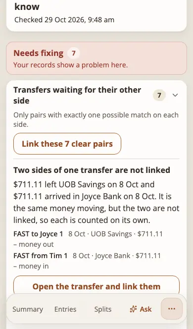 | 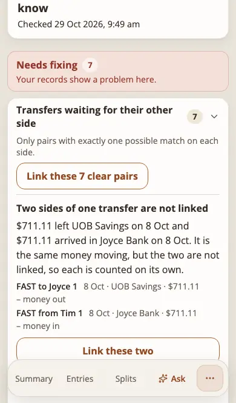 |
| 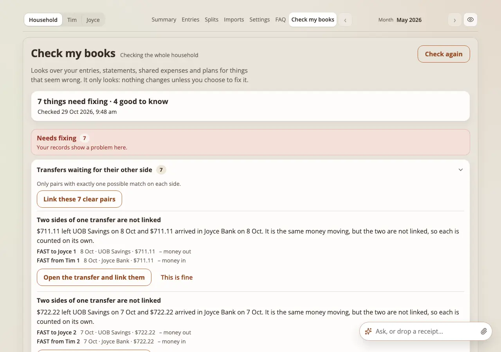 | 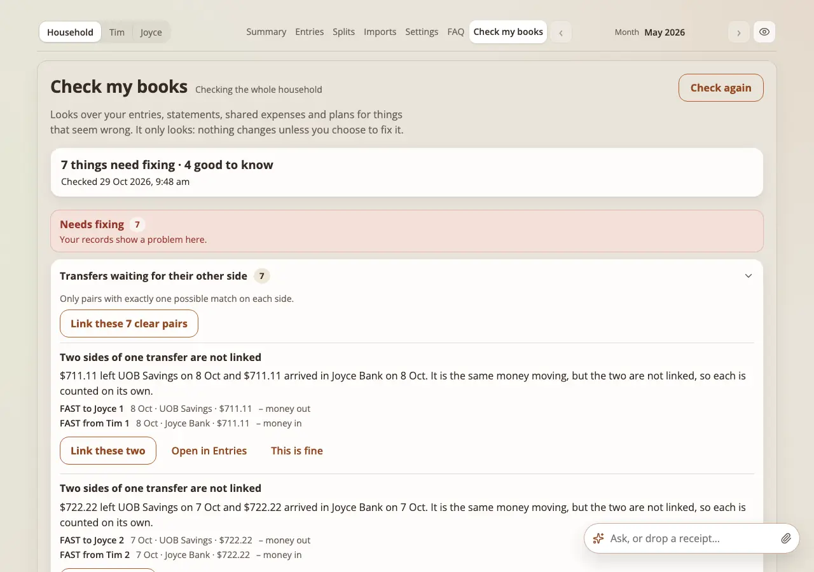 |

The main button now puts the problem right where it is: **Link these two** for two
unlinked sides with one match, **Open transfer details** for a transfer with
several matches or none, **Correct this** for a mistake in a settled period.
**Open in Entries** or **Open in Splits** stays as the quiet second button, and
**This is fine** is unchanged. Every other kind keeps the report's own button
(the entry, Imports, the month's plan, Settings) with the way back below.

## 2. Fix in place, in five frames (visible change)

1. The list (above).
2. **Link these two** opens the app's small confirmation over the page, stating
   money out and money in with date, account and amount (none with money hidden).
3. After **Link these two**: the row has gone, the counts moved, the line under the
   title says "Fixed. 6 things left." for a few seconds, and focus is on the
   next problem's button.
4. **Open transfer details** (several matches) is the Transfer details dialog that
   Entries uses, over the page.
5. **Correct this** is the Correct a settled mistake dialog, over the page.

| Confirm | After | Transfer details | Correct this |
| --- | --- | --- | --- |
| 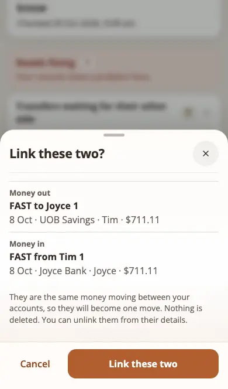 | 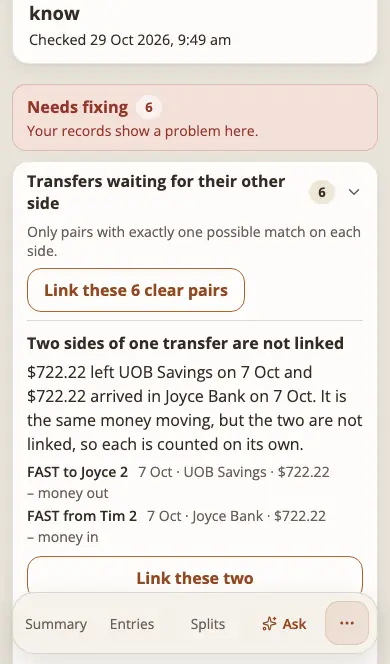 | 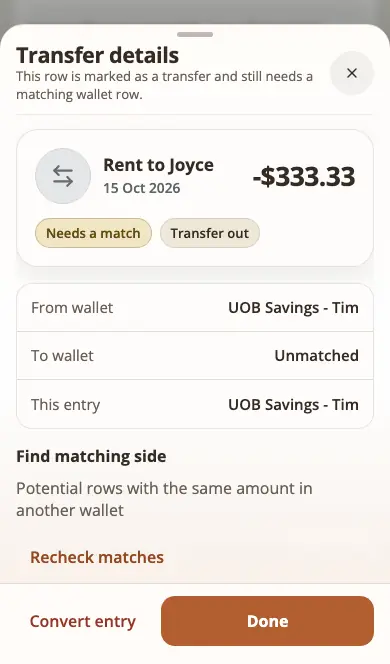 | 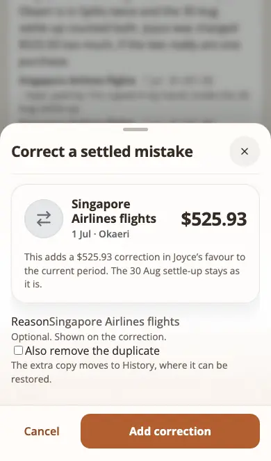 |
| 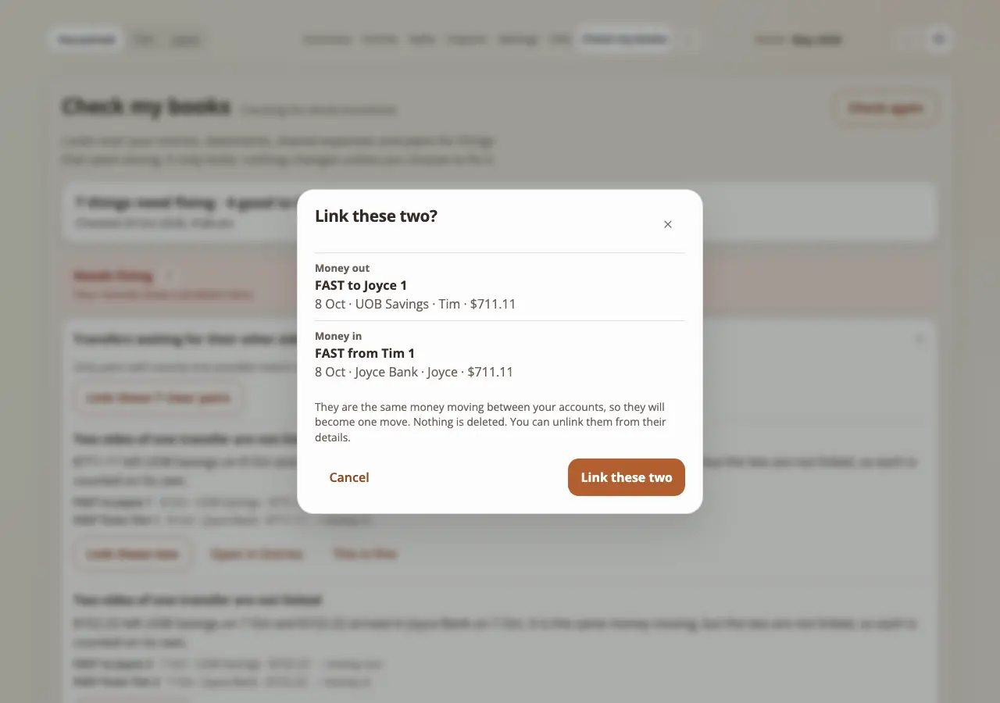 | 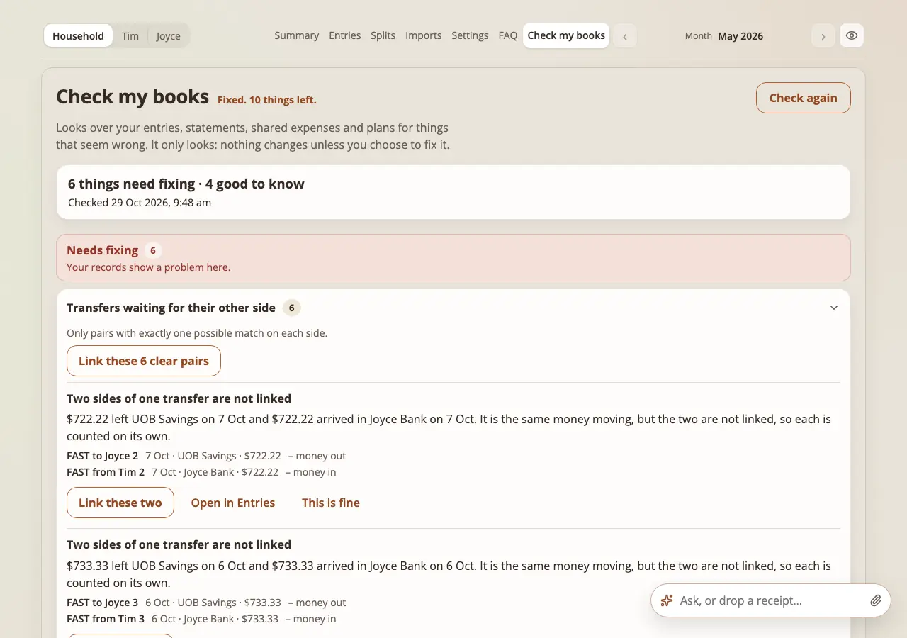 | 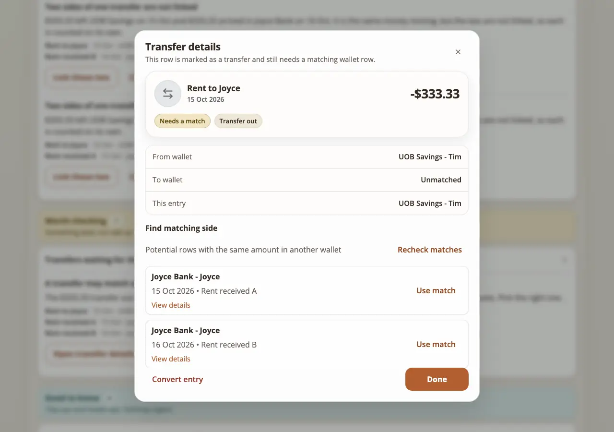 | 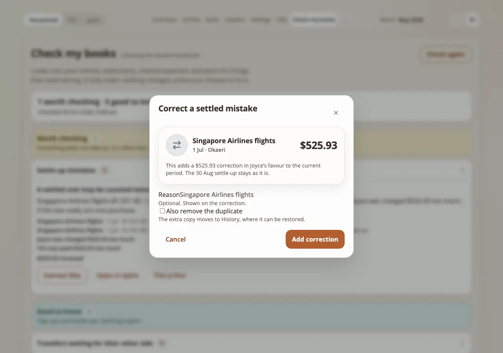 |

## 3. The way back (visible change)

| Before: the entry's sheet, and nothing to go back with | Before: the sheet closed, still nothing |
| --- | --- |
| 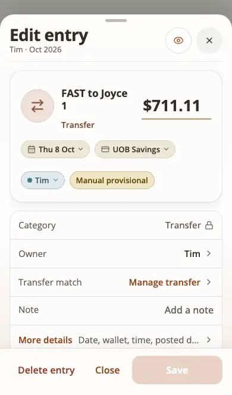 | 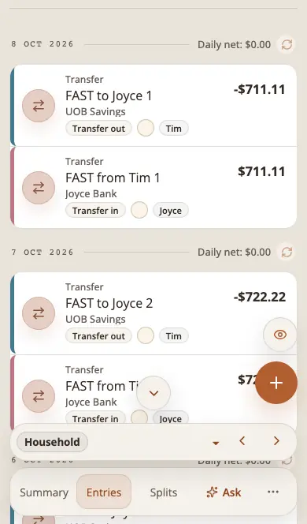 |

| After: the list before leaving | After: Entries, with the link | After: back on the list |
| --- | --- | --- |
|  | 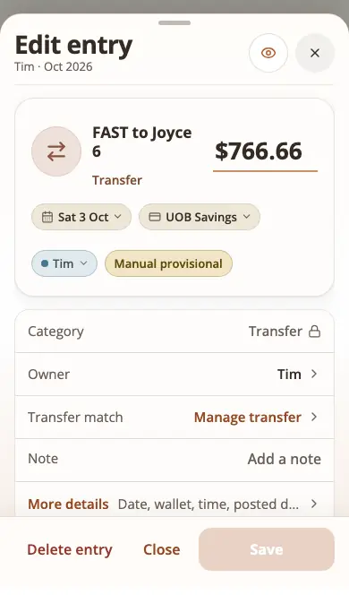 | 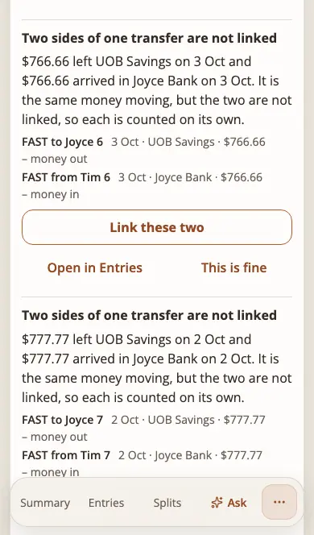 |
|  | 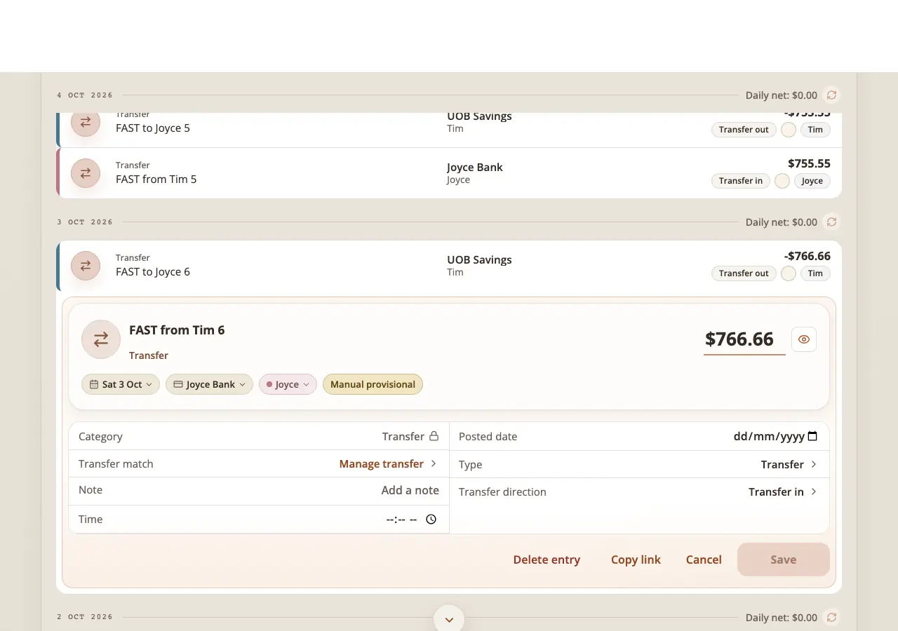 | 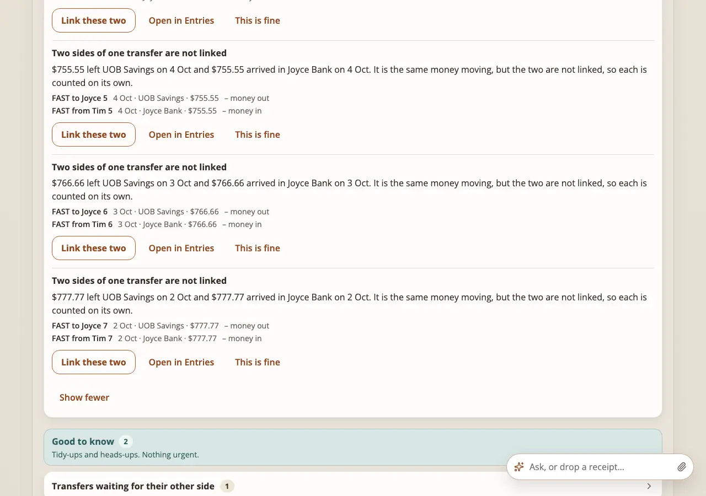 |

"‹ Check my books" sits top left above the page, 44 px tall, on the page Check
sent the person to and on no other. Back on the list the scroll, the groups
opened, the rows shown and the person's view are as they were, the list is read
again, and the line says "Fixed. N things left." or "Nothing changed." The
phone's back gesture and the browser's back do the same.

An entry's own sheet (Entries `editing_entry`) covers the page while it is open,
so the link shows once the sheet is closed (frame 7 shows the sheet open, as the
owner met it); the back gesture works at every moment. Putting the link inside
the sheet's header is a further step for the owner to decide.

## 4. Strings added

See "Fixing and coming back" in `docs/flows/check-flow.md` for the full list.

## 5. Proof

Tests failing on `aea6153b` and passing now: `tests/check-guidance.test.mjs`
(18 tests with the lint extension: the module has no `applyResolved` before) and
`tests/e2e/check-flow-guidance.spec.js` (28 tests, desktop and 390 px; the first
six failed on the old build before the run was stopped). Budgets: the first
screen grew by the link, the marker module and its words (see the commit).
