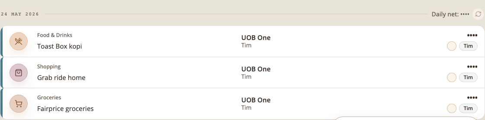
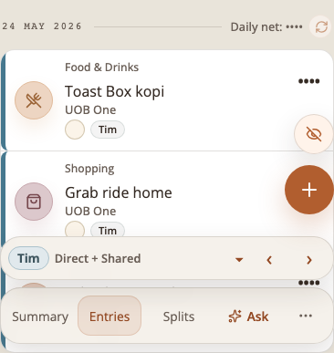
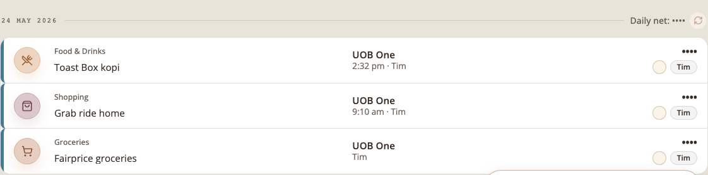
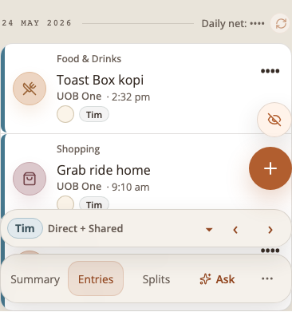
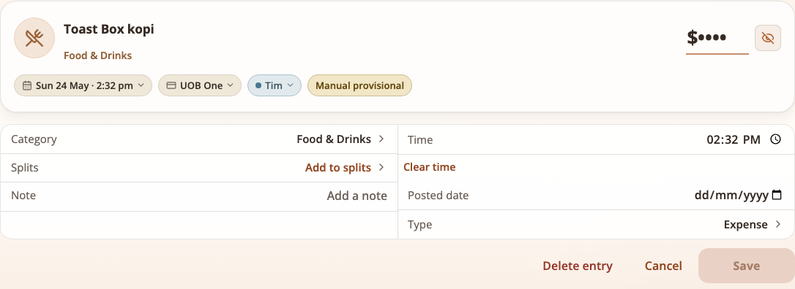
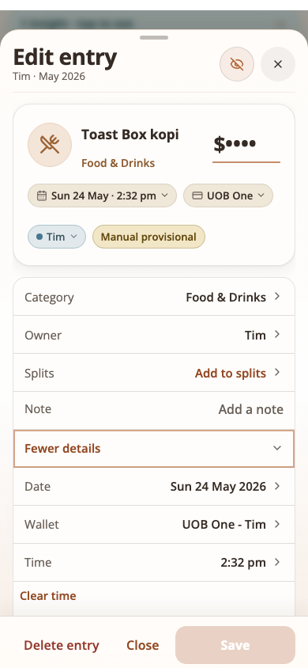

# Entry time of day

Status: shipped 15 October 2026. Owner request: "for Apple Pay shortcuts or
manual entries I think it'll help if we display the time too."

## Decisions

- **Storage.** `transactions.transaction_time TEXT`, nullable, additive: the
  household's local clock time as `HH:MM` (24 hours, Asia/Singapore, which has
  no daylight saving), stored as written so display needs no conversion.
  `created_at` is never used to infer it (a backdated entry was not made at
  that time). Code: `src/lib/entry-time.ts`.
- **When it exists.** Only when the entry is dated today in Singapore: the
  Apple Pay Shortcut (server receive time, because the installed Shortcut
  sends only `date`; the Shortcut runs when the Wallet transaction happens),
  an entry typed in the form (its Time field, now by default for today) and
  an Ask-saved entry (now). Backdated entries and every entry
  from before this change have none, and so does a bank import except a UOB
  PayNow-FAST row (see "PayNow reference" below).
- **Edits.** An update that does not name a time keeps it (also when the date
  changes); the Time row under More details changes it, and Clear time
  removes it. A statement that certifies an Apple Pay entry keeps its time.
- **Not an input to anything.** Matching, wrong-card and duplicate checks,
  estimate pairing and month totals do not read it (proved in
  `tests/entry-time-api.test.mjs`).
- **Ordering.** Days stay newest first. Inside a day the entries with a time
  come first, latest on top (ties keep the existing order); the entries
  without one follow in the order they had before. A total, stable order
  (`orderEntriesWithinDay`). Before this change a day listed its entries in
  the order they were created.
- **Payload.** Only the Entries page sends `time` (`loadEntries(..., { withTime:
  true })`), and only on entries that have one: 15 bytes (`"time":"14:32",`)
  per timed entry, nothing for the rest. Month, Splits and Summary responses
  are unchanged. The API payload budget is untouched.

## PayNow reference (added 26 October 2026)

A UOB PayNow-FAST bank line carries `PIB<YYMMDD><HHMMSS>...`, the moment of the
purchase. At import commit, a new row from such a line stores that time (the
date stays the file's), when the reference is a real date and time within 3 days
of the row's date. It is never written onto a matched Apple Pay or hand-made
entry, which keeps its own time. Existing imported rows stay untimed. Shown the
same way as any time; no new control. Details: DOMAIN.md "PayNow Reference",
`tests/paynow-reference.test.mjs`, `tests/paynow-import-time-api.test.mjs`.

## Display

| Where | Shows |
| --- | --- |
| Entries row, wide screen | second line of the wallet column: `2:32 pm · Tim` |
| Entries row, phone | wallet line: `UOB One · 2:32 pm` |
| Edit entry card date chip, Ask saved card | `Today · 2:32 pm`, `Wed 14 Oct · 2:32 pm` |
| Edit entry, More details | Time row (clearable) |
| New entry form | Time field after Date |
| Day header, Summary, Month | unchanged (date only, no time) |

## New strings

- `Time` (the row, field and its accessible name)
- `Clear time`
- More details hint now lists the time: `Date, wallet, time, posted date, type`
  (certified: `Time, posted date, type`; each with `, added by` when known)
- The time itself reads `2:32 pm` (en-SG style) after `Today`, `Yesterday` or
  the weekday and date, joined with ` · `.

## Screenshots

Before is the same entries with no time (what the app showed before; an entry
without a time renders identically). After has the times.

| | Desktop | Phone (390 px) |
| --- | --- | --- |
| Before |  |  |
| After |  |  |
| Edit, More details |  |  |
