# Check my books: the page and the header's seventh tab

27 October 2026. The screen of the Ledger check-up
([`docs/audits/ledger-checkup.md`](../ledger-checkup.md), "Phase 2",
[`docs/flows/check-flow.md`](../../flows/check-flow.md)). Owner approved the
feature and its wording; this folder is the record of what changed on screen.
Screenshots were taken from the local demo household (Tim and Joyce) with problems
made on purpose (seven transfers whose two sides are not linked, a purchase entered
twice, an entry dated far ahead). "Before" is `origin/master` at `c57999f8`.

## 1. A new page, and the tab that reaches it (visible change)

The seventh page tab, "Check my books", after FAQ on a wide screen; the fourth item
of the `•••` "More pages" menu on a phone and in a narrow window.

| Before | After |
| --- | --- |
|  |  |
| 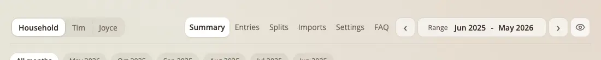 | 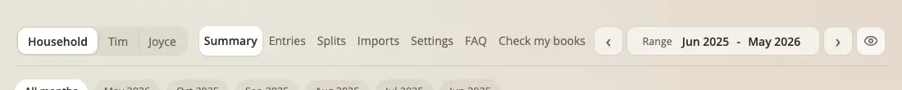 |
| 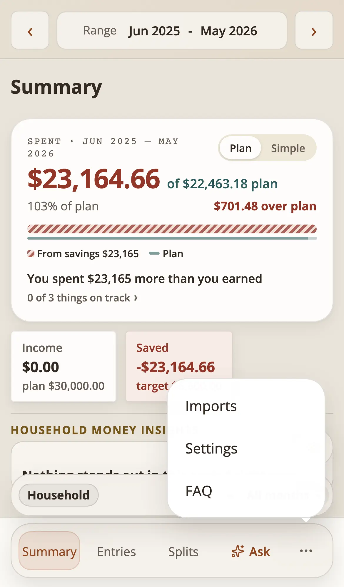 | 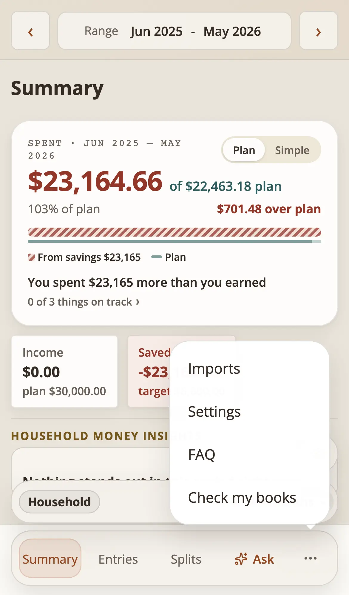 |

## 2. The header's spacing on a wide desktop (visible change, a consequence of 1)

Seven tabs do not fit at the old desktop spacing: the row needed about 1,160 px for
six tabs and about 1,280 px for seven, and the page never grows past 1,164 px (the
shell's content stops growing at a 1,200 px window). The tight spacing the header
already used from 1,100 to 1,199 px now applies at every width of 840 px and more,
with the tab padding 5 px a side instead of 7 so seven tabs fit from 1,100 px.

| | Before (1,440 px) | After (1,440 px) |
| --- | --- | --- |
| header gap | 16 px | 10 px |
| view pill padding | 14 px | 12 px |
| tab strip gap | 4 px | 2 px |
| tab padding | 10 px | 5 px |
| period gap | 6 px | 4 px |
| period box | 260 px minimum, 12 px padding, 10 px gap | 236 px minimum, 10 px padding, 8 px gap |
| text size, header height (57 px) | unchanged | unchanged |

Phones, and windows from 840 to 1,063 px (where Imports, Settings, FAQ and the new
page sit behind the menu), keep their layout. `tests/e2e/header-tab-fit.spec.js`
pins it (every page at 1,100, 1,120, 1,200 and 1,279 px with seven tabs, and the
1,440 px spacing above).

An option not taken: leave the page out of the wide header and show it only in a
menu. A wide header has no room for a menu button either (the row has no slack at
1,164 px), so the spacing had to give.

## 3. The page

| Screen | Image |
| --- | --- |
| Desktop: summary, three sections, groups | 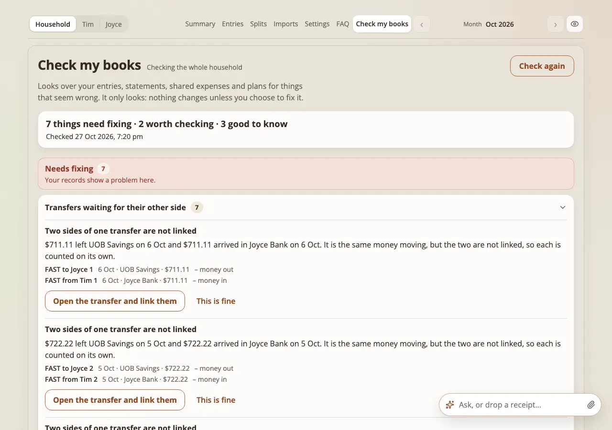 |
| Desktop, a group opened and expanded (full page) | 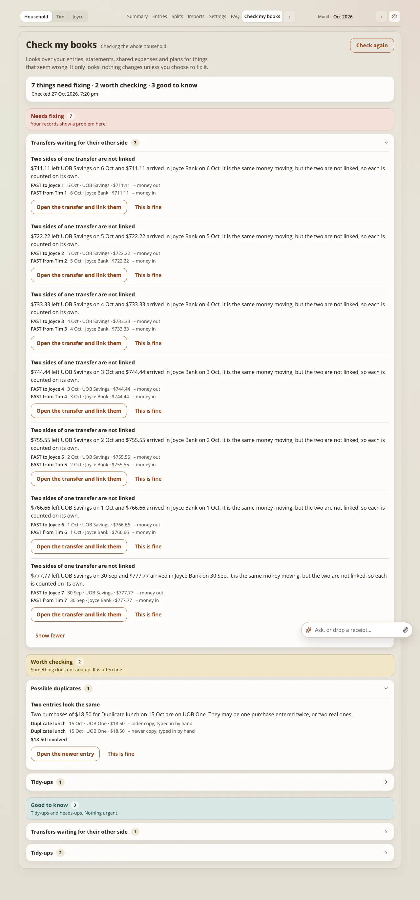 |
| "Showing 50 of 137" and "There may be more than shown" (made-up report) | 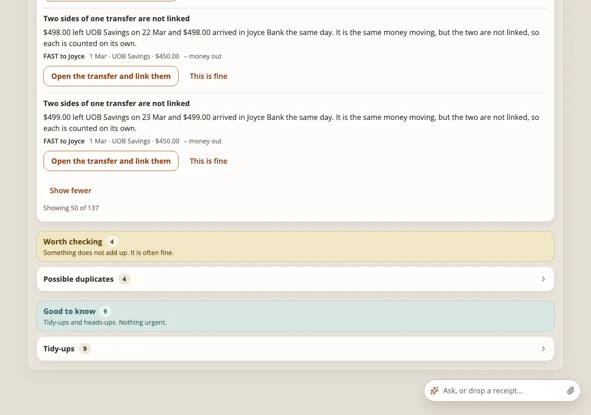 |
| Phone, light | 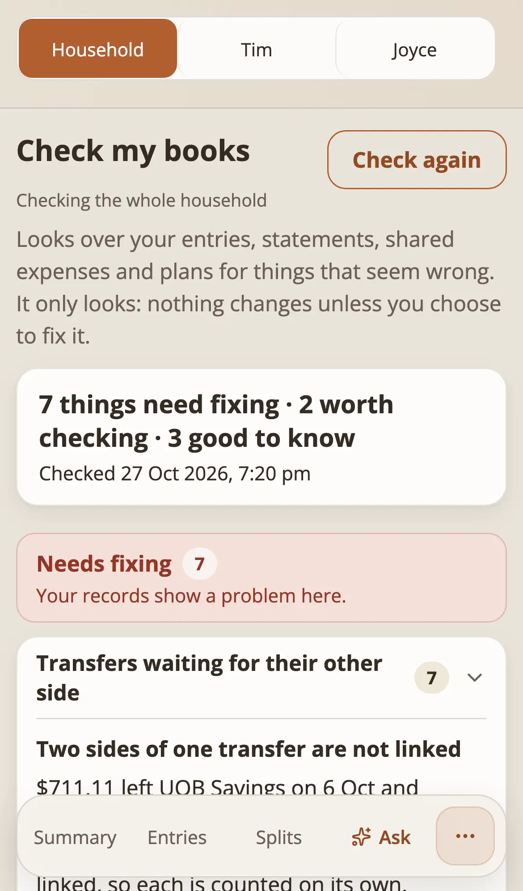 |
| Phone, dark | 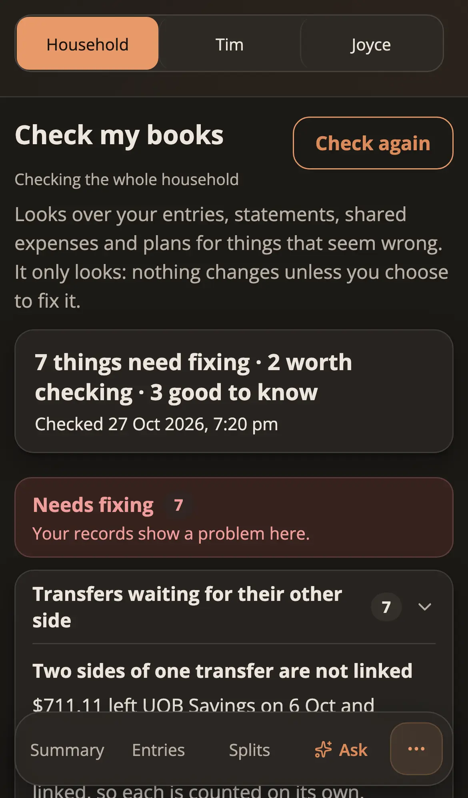 |
| Phone, money hidden: no amount, counts stay |  |
| Phone, nothing wrong | 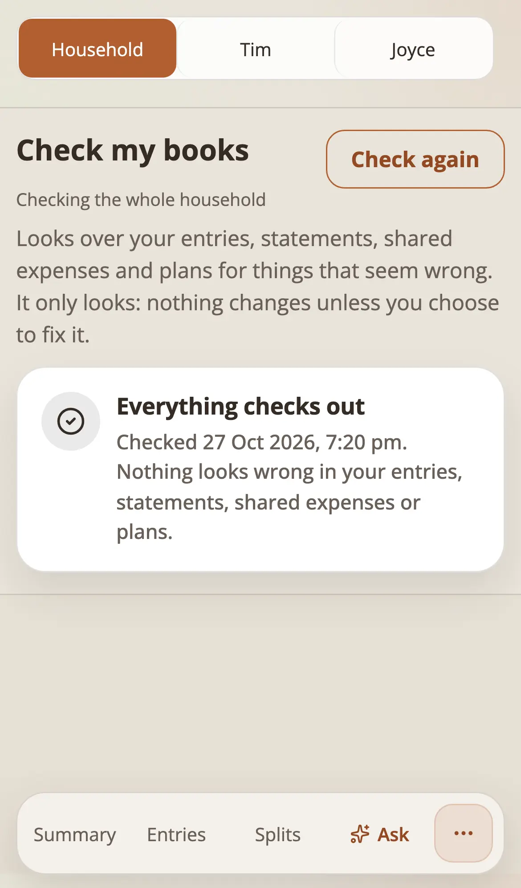 |
| Phone, the first check failed | 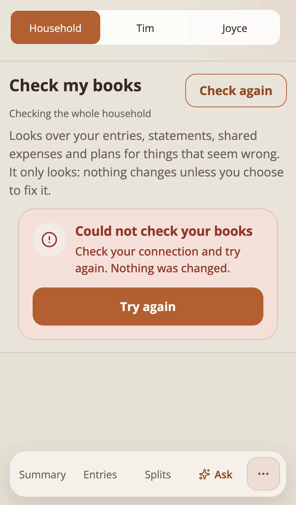 |
| Phone, while it checks (skeleton, disabled "Checking…") | 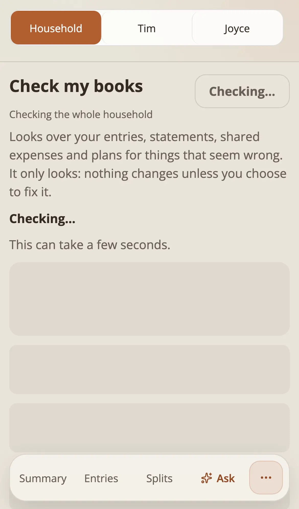 |

## 4. Every new string

The page's own words are in `src/client/copy/check-copy.js`; the list as shown to
the person is "Visible User Contract" in
[`docs/flows/check-flow.md`](../../flows/check-flow.md). The tab's name is
`messages.tabs.check` ("Check my books"). The sentence, lines and fix label of each
problem are the report's (phase 1, linted in `tests/ledger-checkup-detectors.test.mjs`).

## 5. What was not changed

Other desktop screenshots in the user guide still show the six-tab header; they were
not regenerated. No colour token was added (the sections use the state-banner tones
and their `-ink`); contrast is pinned for every preset in both modes.
