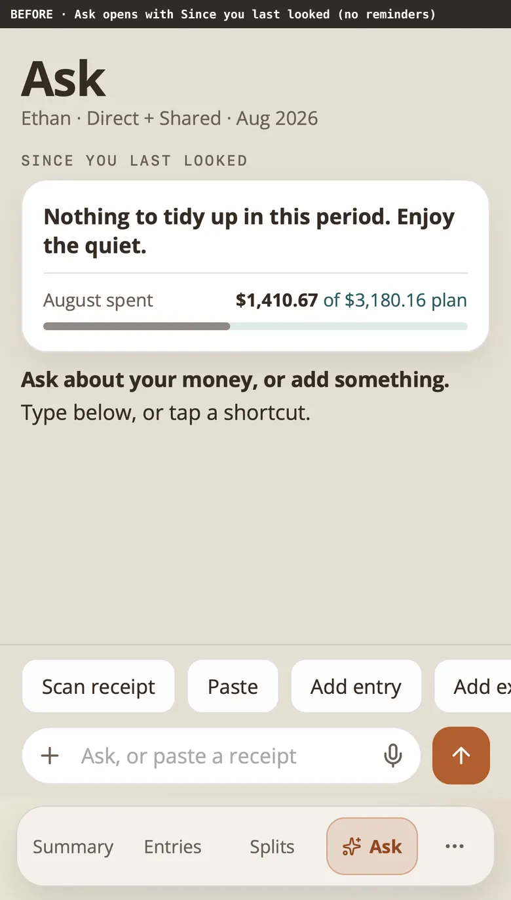
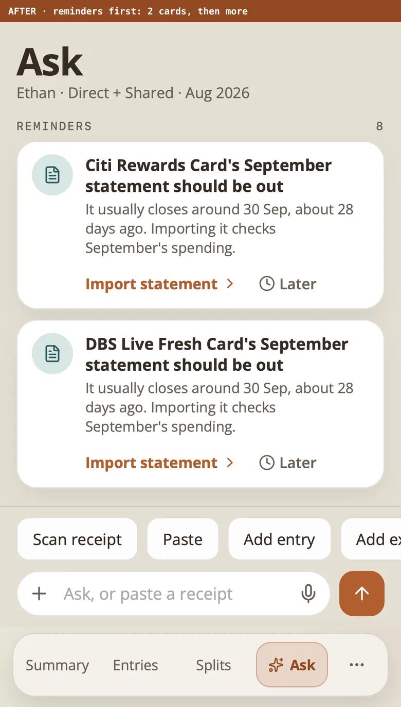
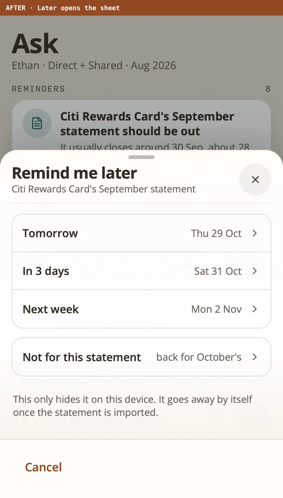
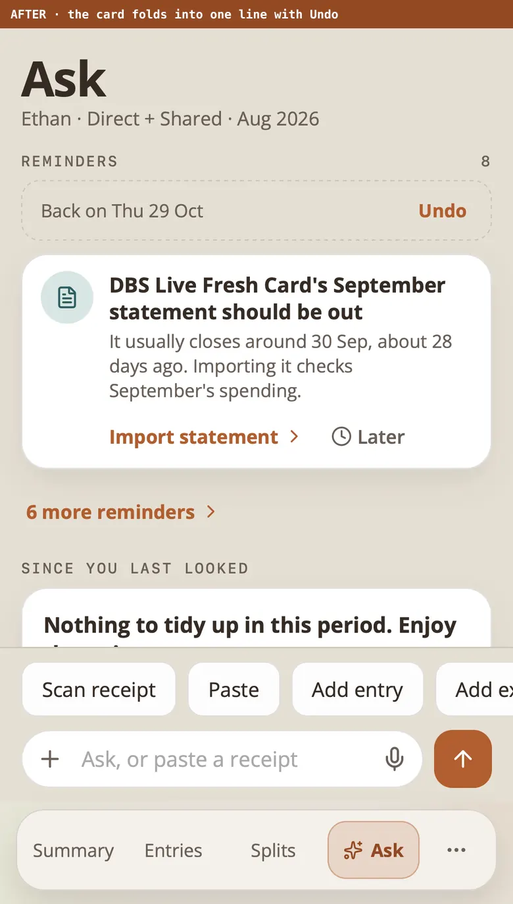
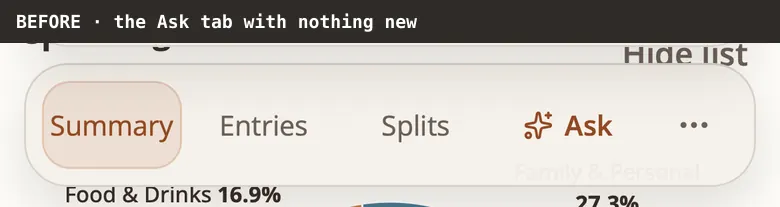
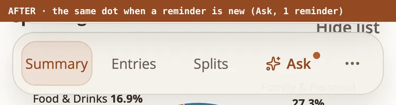
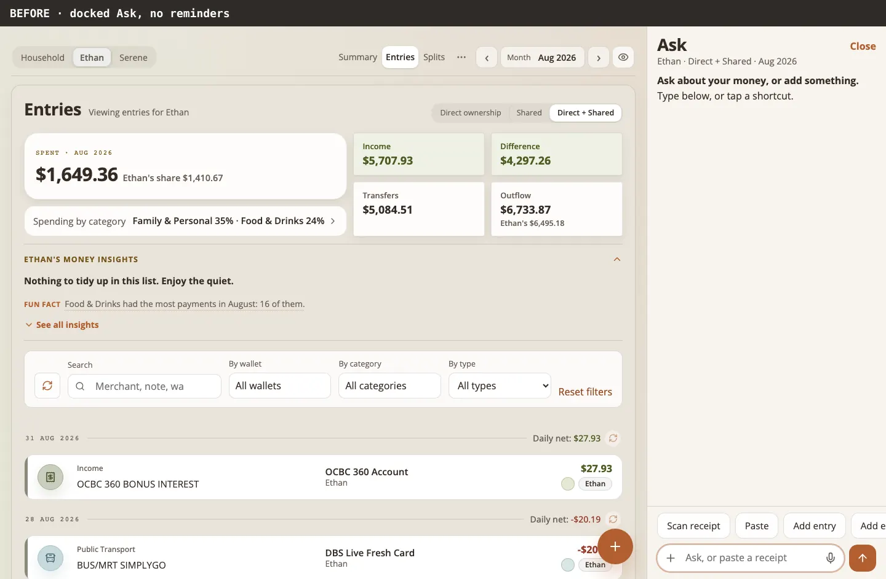
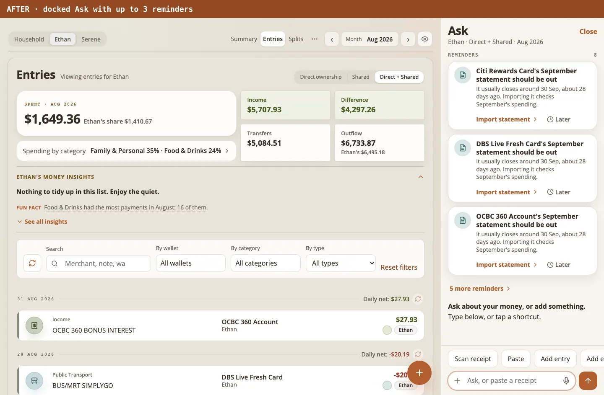
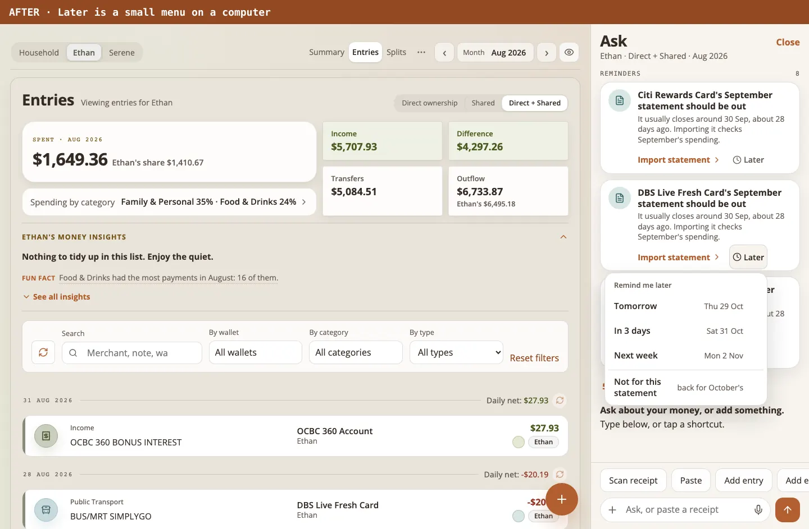

# Reminders in Ask audit

Status: built and shipped 2026-10-28 on the owner's instruction to complete
the proposal (no further review round). The proposal and its mockups are in
[`docs/proposals/reminders/`](../proposals/reminders/README.md); the flow is
[`docs/flows/reminders-flow.md`](../flows/reminders-flow.md); DOMAIN.md
"Reminder" is the vocabulary.

## What shipped

`GET /api/reminders[?view=<person id|household>]` (read-only, at most 20,
about 0.6 KB on the demo household, 2 KB on the 10k household) and a section
at the top of Ask's chat mode that shows them: up to 2 cards on a phone, 3 in
the docked panel, "N more reminders", Later and Got it kept on the device,
the month checklist, and the Ask tab's dot. No AI anywhere, no write, no
table, no schema change.

| Piece | File |
| --- | --- |
| the thresholds, in one place | `src/domain/reminders/thresholds.ts` |
| facts the rules read | `src/domain/reminders/facts.ts` |
| card bill, statement not imported yet | `src/domain/reminders/account-reminders.ts` |
| Splits balance waiting | `src/domain/reminders/splits-reminders.ts` |
| subscription price change | `src/domain/reminders/price-change-reminders.ts` |
| month ready to close | `src/domain/reminders/month-close-reminder.ts` |
| order, "no duplicates", cap | `src/domain/reminders/build-reminders.ts` |
| the loader and the route's answer | `src/domain/pages/reminders.ts`, `src/index.ts` |
| the words | `src/client/copy/reminders-copy.js` |
| cards as data (pure) | `src/client/reminders-model.js` |
| the cards, Later, the checklist | `src/client/reminders-block.jsx`, `reminders.css` |
| what the device remembers | `src/client/reminders-device-state.js`, `reminders-actions.js` |
| the Ask tab's dot | `src/client/reminders-cue.js` (first screen), `app-shell-navigation.jsx`, `ask-dock-field.jsx` |

## The rules as built

Every reminder has a stable key (kind, subject, occurrence), so Later and
"seen" are about one occurrence. `today` is the household's day
(`todayInAppTimeZone`).

| Kind | Shows when | Goes away when |
| --- | --- | --- |
| `card_bill` | a card's latest statement owes money and has a due date; from 7 days before the due date, and up to 30 days after it while less than the minimum (the whole bill when no minimum is printed) is paid. The `card bill` rule of the check-in (`buildCardBillFacts`). One per card, in the viewer's accounts | paid in full or, overdue, the minimum (transfers into the card dated after the statement); 30 days past due; "Paid from another account" or "Not for this bill" on the device |
| `statement_missing` | an active bank or credit card account with at least 2 dated statements: the usual closing day is the median day of the last 3 statement end dates (the lower one for two), kept inside short months; the next statement is expected on that day a month after the latest one; shows from 5 days after that | a checkpoint for that month exists, the account is archived, "Not for this statement" |
| `splits_waiting`, settle-up | an open settle-up (status open, not marked paid) dated more than 14 days ago; whole weeks | paid, matched, settled another way, "Not for this balance" |
| `splits_waiting`, balance | otherwise a group's open balance of at least $20 (a foreign group through its latest rate; none, quiet) whose oldest open record is 28 days old or more | settled, under the floor |
| `price_change` | the same payee (`payeeKey`) charged one amount for 3 or more months in a row (2 yearly charges, a year apart, for Subscriptions YR), then a new amount that differs by at least $1 and 5%; shown for 45 days from the first new charge; Subscriptions MO, Subscriptions YR and Bills only, never a foreign-currency charge, never a payee billed twice in one month | 45 days, Got it; a later change is a new reminder |
| `month_close` | for the last complete month, and for the month before it while that ended no more than 45 days ago: every active statement account that has any statement also has that month's; four checks (statements, nothing in Other, Splits to settle as of the month's end, a month note); done when all four are | one "September is all in" line the next visit, once, and only on a device that showed it open; "Not for this month" |

View scope: a person view reads that person's accounts plus joint ones and
Splits from that person's side; the household view reads every account and
Splits between the two. Order: overdue bills, bills due soonest, month
checklists (oldest month first), statements (oldest first), Splits (longest
waiting first), price changes; ties, more money first, then key. While a
month checklist still asks about Splits, its Splits row replaces the
standalone Splits reminders. "Since you last looked" leaves out the card bill
a visible reminder says (`coveredSignalKeys`; the signal's own key is
`card-bill:<account>:<month>`).

## Against Check my books

Reminders are what is coming up or what to do next; the Ledger check-up is what
looks wrong. They read different facts and do not overlap: the check-up's
`statement_gap` is a month between two statements with entries (a hole), the
missing-statement reminder is the next statement not yet imported (the
future); the check-up has no card bill, settle-up age, price change or month
checklist. The reminders read their own handful of small queries instead of the
check-up's loader (3 round trips, about two dozen statements, built for a
full-ledger audit); `card-bill-projection.ts`, `payeeKey`, the Splits
projection and the Import inbox's month arithmetic are reused rather than
re-derived.

## False-positive analysis

| Risk | Guard |
| --- | --- |
| A bill paid from a bank that is not imported yet looks unpaid | the sentence says "since the statement" (what the records show); "Paid from another account" hides that one bill on the device; the bill goes at the due date plus 30 days |
| A bill paid by an entry not marked a transfer | same; named in the flow's watch areas |
| A statement that is late because the account is dormant | needs 2 statements; only from 5 days after the usual closing day; archived accounts stay quiet; a gap of two months shows one reminder (the next statement) |
| An irregular closing day | the median of the last 3 end dates, not the last one |
| Accounts that never had a statement | quiet (that is Import inbox setup); never hold a month open |
| A settle-up recorded but paid by cash | "Not for this balance"; a matched or marked-paid settle-up is no longer open |
| A tiny or foreign balance | $20 floor in home currency; no rate, quiet |
| A price that moves with rates | foreign-currency charges and any entry with an original currency are never read |
| Two charges in one month from one payee (several items on a bill) | not one series, quiet |
| A one-off or a changed plan | needs 3 monthly (2 yearly) charges at one amount in consecutive periods; a missed month breaks the run |
| A checklist for a month nobody tracks | needs every statement account to have that month's statement |
| Reminders returning when nothing changed | the dot counts only unseen ones; seen is per device and per key |

Residual: a household whose banks publish statements irregularly gets the
missing-statement reminder a few days early now and then; Later and "Not for
this statement" are there for that.

## Measured budgets

On the 10k-transaction household with production's settled split history and
a card bill, a late statement and last month's statements seeded
(`tests/reminders-budget.test.mjs`):

| Measure | Result | Bound |
| --- | --- | --- |
| D1 statements | 16 (13 when no month checklist is possible) | 20 |
| rows read | about 29,600 with a month checklist, about 21,000 without (the 26-month window of yearly subscriptions walks the date index: no index on category) | 250,000 |
| response | 2.0 KB (0.6 KB on the demo household) | 8 KB; payload budget key `reminders` 581 B +10% |
| CPU in the Worker's code (node) | 80 to 110 ms median | 150 ms target; the test bound is 250 ms so a busy machine does not trip it |
| reads | every one from an index (EXPLAIN pinned) | no scan of the ledger |

The app shell's context (categories and every tracked month) is not loaded:
that alone was 3 statements and 30,000 rows. The one read that grows with the
ledger is the subscription charges (about 13 months for monthly series, 26 for
yearly); a `(household_id, category_id, transaction_date)` index would cut it
to the few matching rows, but it is a schema change and the read is cheap
enough at this size, so it is left as the follow-up if ledgers grow. First screen
(`npm run check:bundle`): entry chunk plus Summary route 161,709 B to 162,266 B
gzip (+557 B, within the +5% tolerance; no budget raised), styles 23,707 B to
23,734 B (+27 B). All card code, copy and CSS are in the Ask route's lazy
chunks. Cold start: nothing runs at cold start; the cold-start statement
budget test is untouched and passes.

## The dot

Decision: the dot is derived from the same lazy read that runs when Ask
opens; there is no request for it on the first screen and none through the
warmup scheduler.

Why not a read of its own: Mobile speculative data is admitted only with a
measured row (gzip bytes and handler p95 on the 10k fixture), a reported 4g
connection or an unknown one with a recent required request of 500 ms or
less, and within the visit's data budget. Mobile gets one data read per visit
and the Summary and Month visits (where the app starts) spend it on the
Entries page, so a reminders read could not run where it is wanted most
without taking that read from Entries or raising the mobile budget, and
desktop's two reads per visit go to Entries and Imports. The reminders
read is small (2 KB, 80 to 110 ms), so it would be admitted on its numbers;
the budget is the obstacle, and changing the warmup policy is a larger,
separately measured decision (`docs/audits/macro-loading-baseline.md`). The
rule "never a slower first screen" is kept.

What the person gets: the dot appears for a reminder this device has not
shown yet when the app has the answer, that is after Ask has read it in this
visit: a reminder that comes back from Later (the day arrives while the app
is open), or a new one a refresh found. Opening Ask with it on show clears it.
A reminder that arose while the app was closed is on the cards the next time
Ask is opened; it does not light the dot first. This is stated in the user
guide.

Follow-up if the dot should also work on a cold start: admit one reminders read
per visit on desktop (no admission rule there) and, on mobile, a measured row
in `route-warmup-admissions.js` plus a second data read in the visit budget.
Measured inputs are above.

## Decisions on the proposal's open questions

| Question | Decision and why |
| --- | --- |
| D1. The five kinds and their thresholds | Approved as proposed (7 days before a bill, 30 after; statement 5 days after the closing day; settle-up 14 days; group balance 28 days and $20; price change $1, 5% and 45 days; month close 45 days). One thing the proposal says and an earlier draft dropped is built: a month's checklist stays for 45 days after the month ended, so on 1 to 14 November September's checklist can still show beside October's. |
| D2. Snooze per device or per person | Per device (`localStorage`), as proposed: no new table, no writes, no sync problems, and the card clears itself when the thing is done anyway. The note under Later says so. |
| D3. Month close: guidance or a recorded close | Guidance only: a recorded close needs a new domain term and rules for later edits; the four checks are derived from the books and stay true after an edit. |
| D4. Phone shows 2 or all | 2 and "N more reminders" (3 in the docked panel, 2 in the popup), so the brief still peeks above the chips. |
| D5. The dot: reuse or something new | Reuse the conversation dot (one dot for both, the label says why); no new pattern. Its limit is in "The dot". |
| D6. Card bill amount: plain until overdue or rose | Plain ink until it is overdue, then rose (a debt in arrears); a bill that is due soon is a scheduled payment, not yet a debt, and a list where every figure is rose says nothing. Splits "you owe" is rose, "owed to you" mint, "between" plain, as proposed. |
| D7. Copy | Shipped, with these changes from the mockups: the statement card says "should be out" (the app only infers it from the closing day), "Back on Thu 15 Oct" instead of "Snoozed until" ("snooze" is not a word a person uses), names instead of "him" in the settle-up sentence (it is read for either person), and wording for each hidden-money case. The words are in one file under the jargon lint. |
| Own: what "seen" means | Opening Ask with any reminder on show marks every active reminder seen (the "N more" line says the rest exist), so a third reminder behind "N more" does not keep the dot lit forever. |
| Own: card bill link | "Open card" opens the card's entries (`entry_wallet`); there is no card page, and the payment is recorded as an entry. |
| Own: month checklist tone | The Splits row's amount stays plain ink: the check does not say which way the money goes, and a wrong colour would be worse than none. |

## AI, privacy, cost and write boundaries

No AI: no provider call, no prompt, no allowance unit; the words are fixed
templates over computed facts. Privacy: the route returns names of the
household's own accounts, people and groups and amounts for the signed-in
household only, behind the same access gate as every `/api` route (the Worker
refuses a cross-site write; this route has none); no number from a ledger
description is returned (`payeeName` is the payee's name without codes). The
device memory holds keys (account ids, months) and days, never an amount or a
sentence. Cost: one read of a few small queries when Ask opens and when a save
invalidates a page, nothing scheduled, no allowance. Writes: none on the
server; the device writes its own `monies.reminders.v1`.

## Before and after

Showcase household (Ethan, Serene), the real route and the built app. "Before"
is the app with no reminders (the route answered an empty list), which is what
`origin/master` shows; "after" is the app as shipped. The showcase has no
statement after August, so today's reminders are its late September
statements. The dot pictures use a Later whose day has come (the cache has the
answer, one reminder is new again).

| | Before | After |
| --- | --- | --- |
| Phone: Ask opens |  |  |
| Phone: Later, then the folded line | |   |
| Phone: the Ask tab |  |  |
| Computer: docked Ask |  |  |
| Computer: Later menu | |  |
| Computer: the Ask field |  |  |

## Tests

| Test | Proves |
| --- | --- |
| `tests/reminders-rules.test.mjs` (24) | each kind with a concrete scenario and its negatives: a paid, partly paid, overdue, minimum-paid, far-off bill; an account with fewer than 2 statements, an archived or other person's account, a joint account, a cash wallet; the closing-day median and short months; settle-ups paid, matched, young, zero or between others; groups under the floor, young, settled or foreign with no rate; a price step too small, too old, in another currency, after a missed month, twice in a month, a yearly series; the checklist's four checks, the 45-day tail, a missing statement, no statement accounts; order, ties, determinism, duplicates replaced, empty |
| `tests/reminders-api.test.mjs` (4) | the real Worker and D1: only GET, nothing for a quiet household, each view's list in order with the exact bill, the database identical after reading, a payment and an imported statement clearing their reminders, the checklist counting Other and the note per person |
| `tests/reminders-budget.test.mjs` (3) | statements, rows, bytes, CPU and payload on the 10k household, an empty household, every read from an index |
| `tests/reminders-client-model.test.mjs` (17) | card limits and "N more", words and money on every card, the tones, hidden money, Later and its dates, targets, the folded line, the checklist's one finished line, device memory across a reload, pruning, blocked storage, the dot's count, the headline leaving out a covered card bill |
| `tests/reminders-copy-lint.test.mjs` (4) | no engine term ("rule", "snooze", "occurrence", "key"), no app jargon, no retired name, no sign word in hidden money |
| `tests/e2e/reminders-in-ask.spec.js` (16) | on a phone and in the 1440 docked panel: cards above the brief, 2 or 3 and "N more", Later's sheet or menu and what it remembers, undo, the skips, each action's page, the checklist, hidden money, nothing and no shift when empty, a failed read, add mode and the first screen make no request, the dot appears for a returning reminder and clears when seen, blocked storage, nothing reaching under the panel |
| `tests/e2e/api-performance.spec.js` | the route's timing and its payload budget |

Every one fails on `origin/master` (no rules module, no route, no cards); they
pass here.
