# View and scope sheet: what the mobile chrome redesign removed

Owner question (2026-10-13): the phone's View and scope sheet looks lean
now. Where did the rest of the original go, and was each removal justified?

Compared: `d8221075` (master before the redesign) and `01708b95`
(`origin/master`, which includes the redesign merge `ab712f2e` of
`mobile-chrome-lsd`). The redesign commits are `2d341fd3` (tests first),
`47c82eb8` (the restructure), `91fe751b`, `6507fa80`, `61ffb4b2`, `9d4dee4a`
and `97ebf76c`. The sheet's body moved from inline JSX in `App.jsx` to
`src/client/mobile-context-sheet.jsx` (a lazy chunk); the controls themselves
are the same handlers (`handleViewChange`, `handleStickyScopeChange`, the
Entries `EntriesFilterStack` props).

## Verdict

Nothing was lost. Every control the old sheet had is still in the sheet,
with the same handler and the same URL params. The parts that are gone are
one sentence of help text (still read to screen readers), a second `Done`
button on Entries, and a disabled Household pill that could never be shown.
The sheet looks leaner because its controls are now quiet segmented chips
and flat filter rows instead of filled pills and boxed inputs, and the
`Done` button moved to the bottom bar. It actually shows more than before:
the lead (person chip, scope name and what the scope counts) is new, and the
scope explanation now appears on Month and Entries as well as Summary.

No code was changed. `tests/e2e/mobile-chrome.spec.js` ("view, scope and
filters set exactly the URL params they set before") already proves the
view, scope, every filter, Reset filters and Done behave as before.

The sheet has always been small. Its first version (`b022fa3c`, April 2026)
held only View and Scope; the Entries filters were added in `44932555`.
Nothing moved into the Support bar, Pick a month or another sheet.

## Item by item

Pages: the sheet exists on Summary, Month and Entries only
(`stickyScopeConfig` in `App.jsx`, unchanged). The Scope group appears only
for a person view; the filters only on Entries.

| Item | Before (`d8221075`) | Now (`origin/master`) | Verdict | Why |
| --- | --- | --- | --- | --- |
| Title "View and scope" | Sheet head, all pages | Sheet head, all pages, under a new drag handle | Kept | Unchanged. |
| Help line "Change the active household view without scrolling back to the top." | Visible under the title, all pages | Screen-reader only (`Dialog.Description className="sr-only"`) | Justified | It describes the app's own mechanics, not the person's money, which the copy rule in `AGENTS.md` asks us not to do. The new lead says what you are viewing instead. Screen readers still hear it as the dialog's description. |
| Head `Done` (top right) | Sheet head, all pages | Bottom bar `Done` (primary, full width when there are no filters) | Moved, justified | Same action (closes the sheet). It now sits under the thumb in the shared sheet bottom bar (`BottomActions`), like the other phone sheets. Swipe down, the backdrop and Escape also close the sheet. |
| View: Household and one button per person | "VIEW" title and filled pills, all pages | "VIEW" label and segmented chips (`role="group"`, `aria-pressed`), all pages | Kept | Same buttons, same `handleViewChange`. |
| Household pill disabled on Splits | Code branch inside the sheet (`renderedTabId !== "splits"`) | Removed | Justified (unreachable) | The sheet never renders on Splits: `stickyScopeConfig` is `null` there, before and after. Splits has its own group strip and sheet. |
| Scope: Direct ownership, Shared, Direct + Shared | "SCOPE" title and pills, person views | "SCOPE" label and segmented chips, person views | Kept | Same buttons, same `handleStickyScopeChange` and params (`scope`, `entries_scope`). |
| Scope explanation ("Ethan's entries plus their share of split expenses.") | Under the scope pills, Summary only | In the lead under the scope name, on Summary, Month and Entries | Moved, better | Now on every page with a scope. |
| Who you are viewing (person chip, scope name) | Not in the sheet (only on the bar) | Lead: the person's chip in their colour (`ContextPersonChip`) and the scope name | Added | New. |
| Entries: Search | Filters section, boxed field | Detail row "Search" | Kept | Same `EntriesFilterStack` field and `entry_search` param. |
| Entries: By wallet, By category, By type | Filters section, boxed selects | Detail rows that open the same pickers | Kept | Same pickers and params (`entry_wallet`, `entry_category`, `entry_type`). |
| Entries: Reset filters | Link at the end of the filters | Bottom bar, quiet action left of `Done` | Moved, justified | Same `onResetFilters`; still keeps the sheet open. |
| Entries: second `Done` (end of the filters) | Beside Reset filters, so Entries had two `Done` buttons | Merged into the one bottom bar `Done` | Justified (duplicate) | Both called the same close (`onDone` was `onCloseMobileContext`). |
| Entries: "Filters · N" toggle and Refresh | Hidden on the phone (`hideToggle`, `hideRefresh`) | Hidden on the phone | Unchanged | Neither sheet ever showed them. |

Outside the sheet, on the bar: Entries used to show the words "View and
scope" (or "View") in the trigger. It is now the person chip, the short
scope name and a ▾ caret; the words stay as the trigger's accessible name.
Summary and Month already hid them before, so their bar fits the month chip
on one row. This is a Support bar change, not a sheet change, and it does
not remove a control.

Note: Ethan's chip in the demo is warm grey because `getPersonColour` gives
any name other than Tim and Joyce a stable palette colour; it matches his
Entries row edge.

## Screenshots

iPhone 13 profile (WebKit), showcase demo data, seed month 2026-10, sheet
opened from the floating bar. Before is `d8221075`, after is `01708b95`.

| Page | Before | After |
| --- | --- | --- |
| Summary, Ethan | 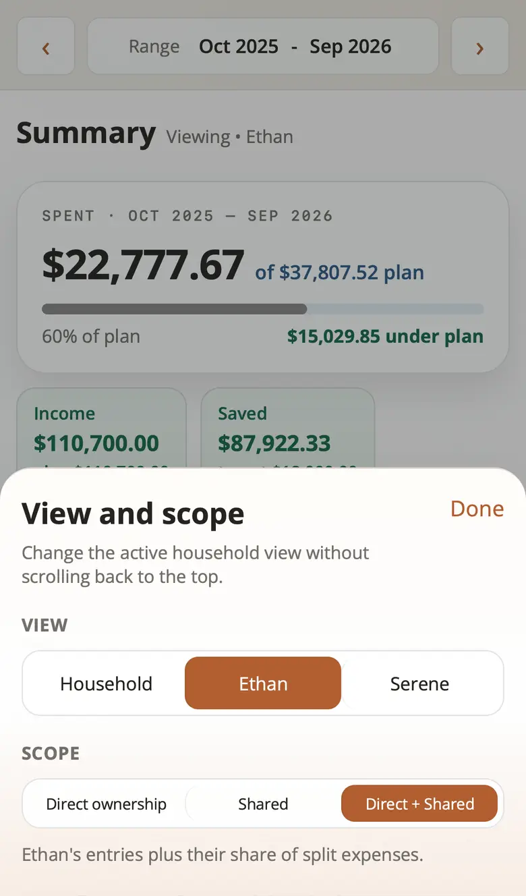 | 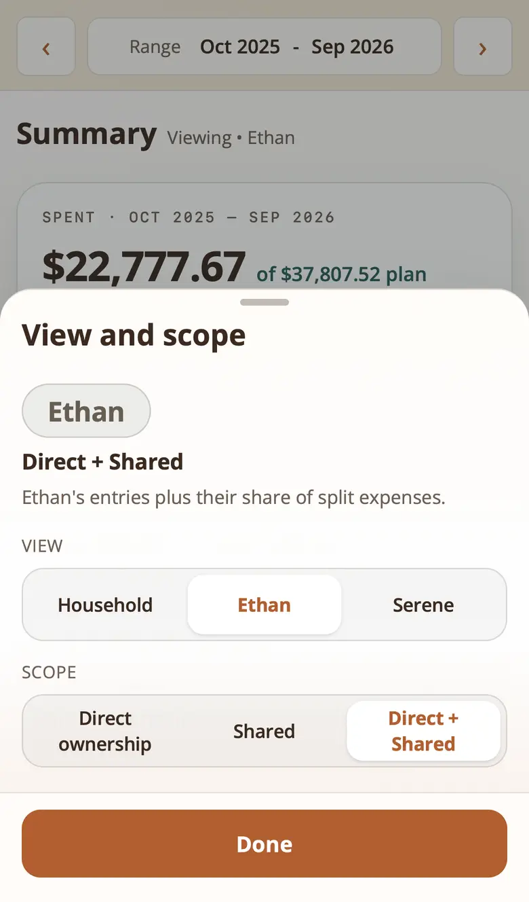 |
| Summary, Household | 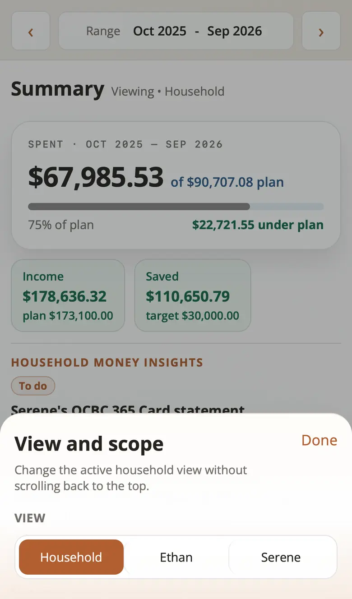 | 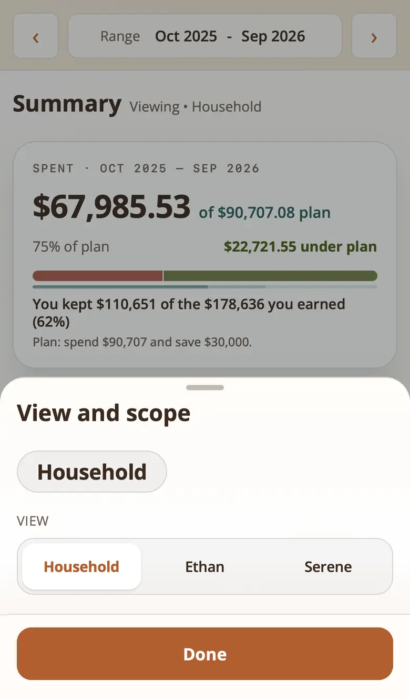 |
| Month, Ethan | 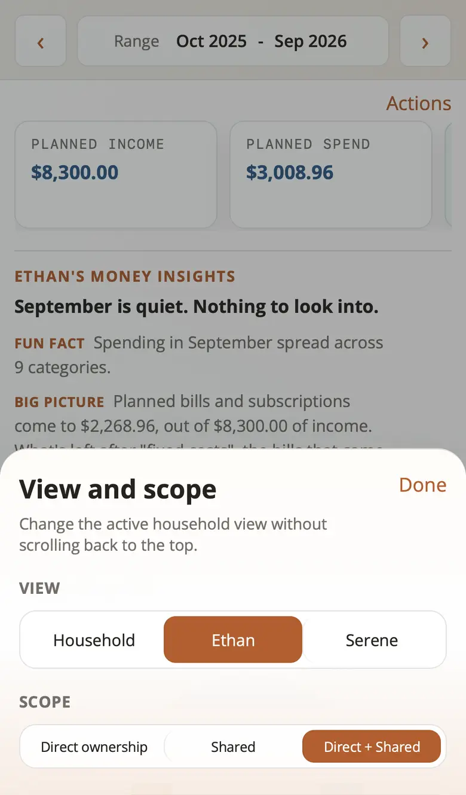 | 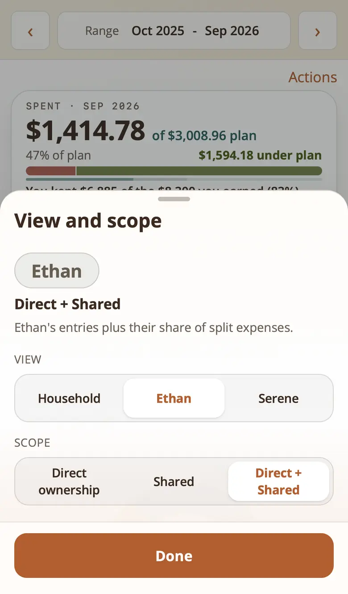 |
| Entries, Ethan | 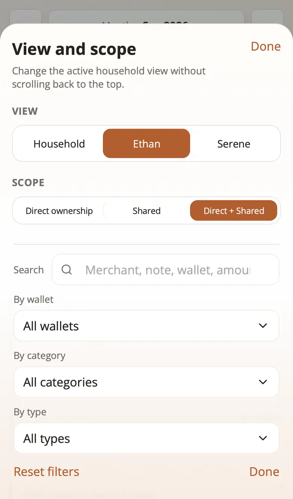 | 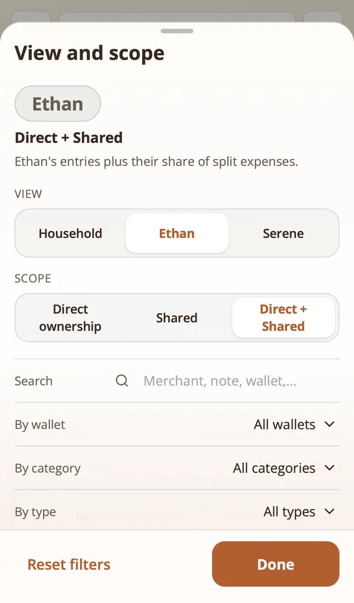 |
| Entries, Ethan (sheet scrolled to the end) | (fits without scrolling) | 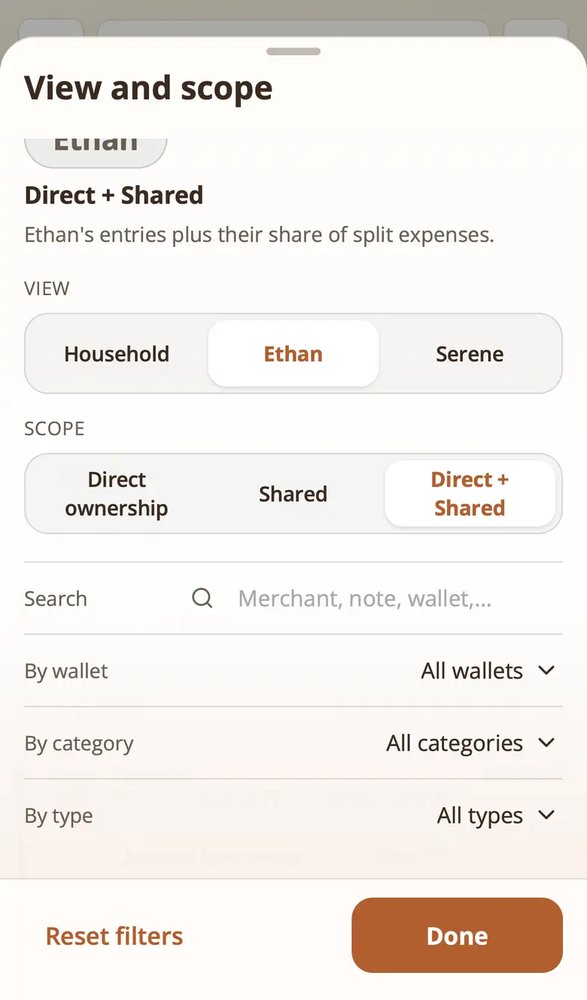 |
| Entries, Household | 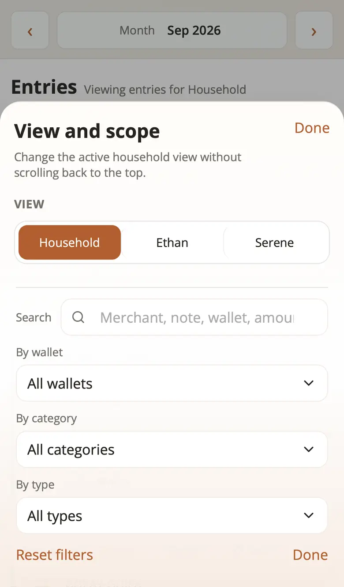 | 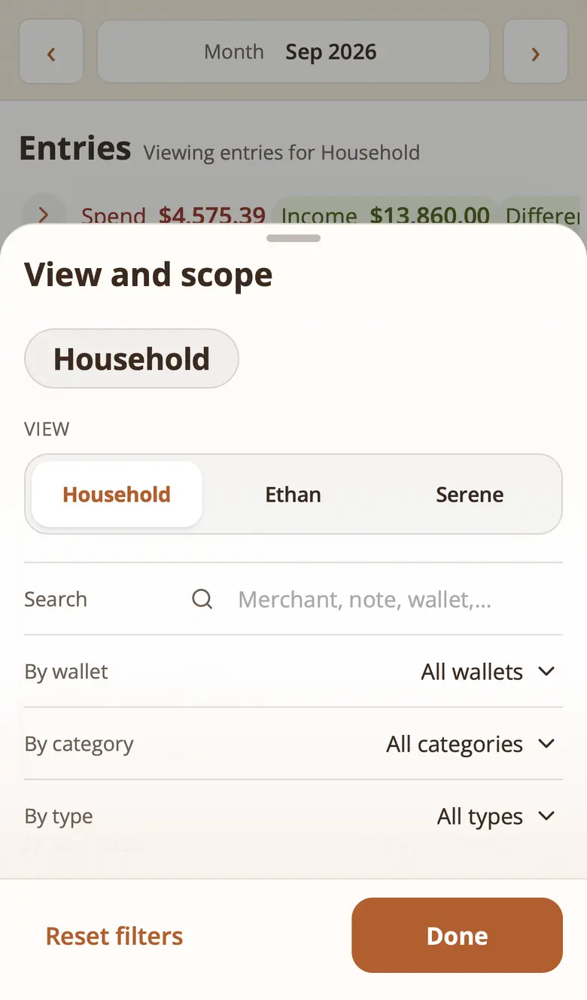 |

Every button each sheet offers, read from the dialog in the same run:

- Summary or Month, person view. Before: `Done`, `Household`, `Ethan`,
  `Serene`, `Direct ownership`, `Shared`, `Direct + Shared`. After: the same
  seven.
- Summary, Household. Before and after: `Done`, `Household`, `Ethan`,
  `Serene`.
- Entries, person view. Before: the seven above, the three pickers
  (`All wallets`, `All categories`, `All types`), `Reset filters` and a
  second `Done` (12). After: the same, with one `Done` (11), plus the Search
  field in both.

## How the screenshots were made

Each commit was built (`npx vite build`) in its own worktree, then a small
Playwright script started an isolated stack with `scripts/e2e-stack.mjs`
(`DEMO_DATASET=showcase`, `DEMO_SEED_MONTH=2026-10`, ports 6941, 10341 and
10941, so it never touches 5173/8787 or the guide's 5442/8842), reseeded
through `POST /api/demo/reseed`, opened each URL at `month=2026-09`, tapped
`.mobile-context-trigger` and took a viewport screenshot.
