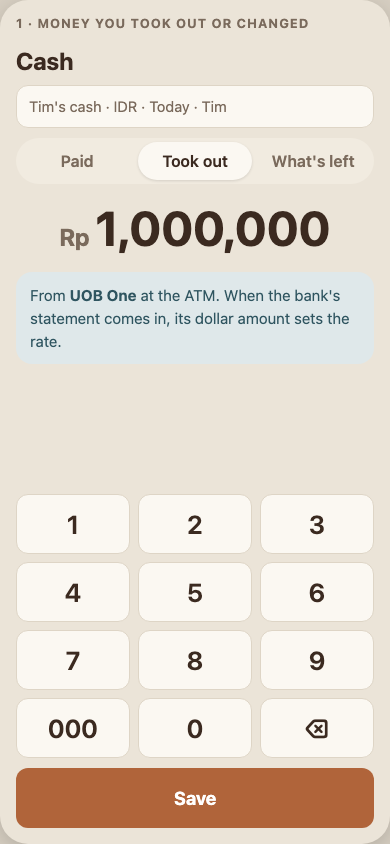
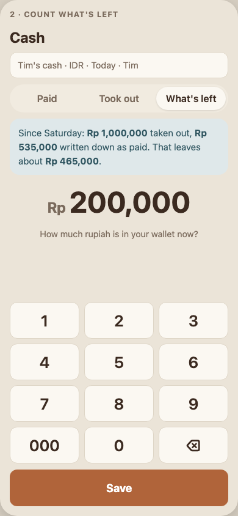
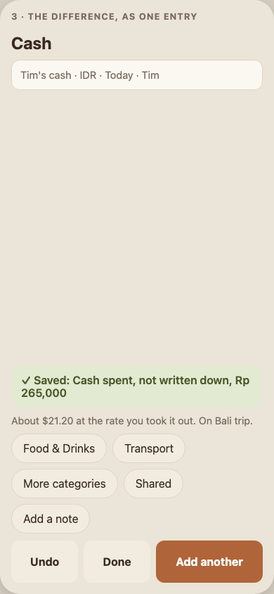

# Proposal: Count what's left (not built)

Status: proposal for the owner, 17 Nov 2026. Nothing here is built. It
follows the cash pad (DOMAIN.md "Cash Entry", `docs/flows/cash-entry-flow.md`).

## The idea

Logging every coin is still work, even at four taps. On a trip, many
people only know two things for sure: how much cash they took out or
changed, and how much is in the wallet now. So instead of (or as well as)
logging each payment, the person:

1. records cash coming in: an ATM withdrawal abroad, a money changer, cash
   brought from home;
2. at any time, types what is left;
3. the app books the difference as one entry: "Cash spent, not written
   down".

Payments they did log still count; only the gap is booked.

| 1. Took out | 2. What's left | 3. The difference |
| --- | --- | --- |
|  |  |  |

(Mock screens drawn from `cash-count/mock.html`, in the cash pad's shapes
and the app's light colours. The Paid / Took out / What's left switch is a
proposal and would need the owner's approval.)

## How it fits the domain

### The cash wallet's balance, per currency

Today a cash wallet is an account with one currency (SGD) and foreign cash
entries keep `original_amount_minor` and `original_currency` beside the
SGD estimate. Two ways to know "rupiah in hand":

- A. One account per currency ("Tim's rupiah", an IDR account). The ledger
  would then hold IDR amounts natively, and every projection that sums
  accounts (Summary, Month, pace, Money insights, Splits' home amounts)
  would need a conversion it does not have today. Large and risky.
- B. Keep the SGD cash wallet and derive a per-currency balance from the
  kept original amounts: rupiah in (withdrawals and changes recorded in
  IDR) minus rupiah out (entries on the wallet whose original currency is
  IDR). Pure, read-only, bounded by the trip's dates. **Recommended.**

### Cash coming in is a transfer

An ATM withdrawal abroad is money moving from the bank account to the cash
wallet, so it is a Transfer pair (DOMAIN.md "Transfer"), never income or an
expense: out of UOB One, into Tim's cash, with the rupiah amount kept as the
original amount on the cash side. When the bank statement arrives, its SGD
line is the bank side of the pair, and its dollar amount is the true rate
for that cash, fees included. A money changer is the same with the cash
wallet on both sides (SGD notes out, IDR notes in), or a transfer from the
bank when changed at a counter by card.

### The rate used

The booked difference is rupiah; its SGD amount needs a rate. Options:

- the rate of the cash in hand: the SGD paid for the rupiah taken out (from
  the withdrawals and changes on this trip), averaged by amount. This is
  what the cash actually cost, so the trip's total in dollars matches what
  left the bank. **Recommended.**
- the day's market rate (what cash entries use today): simpler, but the
  trip's dollars then drift from the bank's by the fees and spread.

Until a withdrawal's bank line arrives, its rate is the day's rate, marked
as an estimate like a Foreign Currency Estimate, and it settles when the
statement comes.

### The booked entry

One expense on the cash wallet, in the trip's currency, described "Cash
spent, not written down", category Other (the person can tidy it like any
cash entry: the chips after Save), external reference `cashcount:<id>`, a
note with the sum ("Took out Rp 1,000,000, wrote down Rp 535,000, counted
Rp 200,000 left"). It is on the trip by the existing dashed chip rule.

## What it would change

- Domain: a pure `cashOnHand` projection (per currency, per wallet, over a
  date window) and a "cash count" command that books one entry through
  `createEntryRecord` (all or nothing, idempotent on a request id).
- The pad: a way to say "Took out" (a transfer with an original amount, the
  bank account chosen once and remembered) and "What's left" (shows the
  expected amount, takes the count, books the difference).
- Entries: the booked entry shows like any other; its note explains it.
- Docs, guides and an audit note, as for the cash pad.

## Risks

- Counted twice: a payment logged after the count but dated before it would
  be inside the booked difference too. The count must close the window: a
  later entry dated before the last count asks "Was this part of what you
  counted?"
- More left than expected (a negative difference): money found, a
  withdrawal not recorded, or a payment logged twice. Never book income by
  itself; ask which, and offer "Took out" for the missing withdrawal.
- A forgotten withdrawal makes every later count wrong. The Ledger check-up
  could list cash wallets whose count went negative.
- Shared spending: an unlisted sum cannot be split by shop. Splits stays the
  person's choice (Shared on the booked entry splits it whole).
- Categories: large "Other" sums make Spending by category vaguer. The
  booked entry should say so in plain words and offer the chips.
- Two currencies in one wallet on one trip (rupiah and dollars) need a count
  per currency; the first slice should refuse a second currency.
- Statement reconciliation of the bank side is unchanged, but the cash side
  has no statement: the count is its only check.

## Recommended first slice

"What's left" for one cash wallet in one foreign currency, on a trip that is
on today:

1. **Took out** on the pad records a withdrawal or change as a transfer pair
   with the rupiah kept (bank account chosen once, remembered per device);
   its rate is the day's rate until the statement line arrives.
2. **What's left** shows "Since <first day>: Rp X taken out, Rp Y written
   down as paid. That leaves about Rp Z." and takes the count.
3. Save books the difference as one entry at the rate of the cash in hand;
   a negative difference asks instead of booking; Undo removes it.

Out of the first slice: several currencies in one wallet, cash brought from
home, automatic matching of withdrawals to ATM lines on statements (the
existing transfer matching may already pair them), and any change to
Splits.
