# Proposal: reminders in Ask

Status: **mockups for owner approval. No app code is in this branch.**
Roadmap item "Next": in-app reminders shown in Ask, with a small dot on the
Ask tab. Nothing here is built; every picture is the real app (showcase
data, local isolated stack) with the proposed cards injected using the app's
own tokens and classes.

## In one paragraph

When you open Ask, up to a few short reminder cards sit at the top of the
conversation, above "Since you last looked": a card bill due soon, a
statement that should be out but isn't imported, a Splits settle-up that has
waited weeks, a subscription whose price changed, and, once a month's
statements are all in, a "ready to close" checklist for that month. Fixed
rules over data the app already holds decide when each one shows. No AI
decides anything, nothing is pushed, emailed or sent anywhere, and each card
goes away by itself once the thing it asks for is done. "Later" snoozes a
card on this device. A small dot on the Ask tab (phone) or the Ask field
(desktop) says there is something new, using the same dot Ask already shows
for a conversation in progress.

## Where reminders appear

- **Ask, chat mode only**, the first thing in the conversation after the
  Claude credit notice (when that shows) and before "Since you last looked".
  Not in add mode (Entries +, Splits receipt, Apple Pay Shortcut), not on
  any other page, never as a banner over a page, never a modal or a browser
  alert.
- **Phone**: at most 2 cards, then "N more reminders" (one 44 px text
  button that opens the rest in place), so the brief still peeks above the
  chips. **Desktop docked panel (1280+)**: at most 3, then "N more".
- **The cue**: the existing 7 px accent dot (`.tab-dot`) on the phone Ask
  tab; on desktop the same dot on the Ask field's sparkle while the panel is
  closed. No count badge, no new colour.
- **Not in v1**: push notifications, email, calendar invites, the Web
  Notification API, home-screen badges, a Settings page for reminders.

## The rules (deterministic, from existing data)

Every reminder has a stable key (kind, subject, occurrence), so snoozing and
"seen" are about one occurrence: next month's statement is a new reminder.

| Reminder | Fires when | Data it reads (all existing) | Goes away when |
| --- | --- | --- | --- |
| **Card bill due** | A card statement owes money and has a due date; from 7 days before the due date, and up to 30 days after it while less than the minimum is paid. This is today's `cardBillSignal` rule (DOMAIN.md "Card Bill"). | `account_balance_checkpoints.payment_due_date`, `minimum_payment_minor`, statement balance; transfers into the card dated after the statement date. | Paid in full (or, overdue, the minimum) per the ledger; 30 days past due; or "Paid from another account" in the snooze sheet (that payment may be from a bank not imported yet). |
| **Statement not imported yet** | An active bank or card account with at least 2 statements: its usual closing day is the median day of its last 3 statement end dates; the next statement is expected on that day a month after the latest one; the reminder shows from 5 days after that (banks publish the PDF a few days late) while no checkpoint exists for that month. | Statement checkpoints (`statement_end_date`, `checkpoint_month`), the same "next expected statement month" the Import inbox uses (`import-inbox.ts`). | The statement is imported (a checkpoint for that month exists), or the account is archived. Accounts with no statements yet stay quiet (that is Import inbox setup, not a reminder). |
| **Splits balance waiting** | (a) An open settle-up (settlement checkpoint, status open, not marked paid) older than 14 days: "Settle-up with Ethan waiting 5 weeks". (b) Otherwise a group's open balance of at least $20 (or the group currency's equivalent) whose oldest unsettled record is 28 days old or more. Weeks are whole weeks since the settle-up date or the oldest record. | Splits page facts: `split_settlement_checkpoints`, group balances, record dates. | Marked paid, matched to a payment, settled up, or the balance falls under the floor. |
| **Subscription price change** | The same payee (`payeeKey`, as Account routine uses) charged at one amount for 3 or more months in a row (2 yearly charges for yearly subscriptions), then at a new amount that differs by $1 and 5% or more; shown for 45 days from the first new charge. Only Subscriptions MO, Subscriptions YR and Bills, and never a foreign-currency charge (exchange rates move every month). | Ledger entries of those categories, about 13 months back. | 45 days pass, or "Got it". A later change is a new reminder. |
| **Month ready to close** | For the last complete month, from the day every active statement account has its statement for that month, until all four checks are done or 45 days after the month ended. | Checkpoints; entries of the month in Other; open Splits records dated in or before the month that involve the view's person; `monthly_notes` for the month. | All four checks done: the next visit shows one mint line, "September is all in", then nothing. |

The four month checks, in order: statements imported (done by the time the
card shows; listed so the person sees the hard part is done), nothing left in
Other (no category), Splits to settle, and a month note. Each open row opens
its page (Imports, Entries filtered to Other, Splits, Month note).

**Views.** A person view shows reminders for accounts that person owns plus
joint ones, and Splits from that person's side ("You owe Ethan"). The
household view shows every account and Splits between the two ("between
Ethan and Serene").

**No duplicates.** While a month-close card shows, its Splits item replaces
the standalone Splits reminder. "Since you last looked" keeps its own
headline but skips one about the same subject as a visible reminder (for
example the card bill) and shows its next headline instead.

**Order.** Overdue bills, then bills due soonest, then month close, then
statements (oldest first), then Splits (longest waiting first), then price
changes. Ties: more money first.

**Money tones.** Text only, as everywhere: a card bill is plain ink until it
is overdue (then rose, a debt); "you owe" in Splits is rose and "owed to
you" mint; a price change is plain ink. With money hidden, amounts are
`••••`, tones go, and no words reveal a sign ("Agreed on 6 Sep to even out
your shared costs", not "you agreed to pay him").

## Dismiss and snooze

- **Later** on each card. On a phone it opens a bottom sheet in the mobile
  sheet's look; on desktop a small menu under the button, like "More pages":
  - Tomorrow · In 3 days · Next week (the coming Monday), each with its date;
  - one "skip this one" choice for the kind: "Not for this statement" (back
    for October's), "Not for this bill", "Not for this month", "Paid from
    another account" (card bill only).
- **Price change** has "Got it" instead of Later: it dismisses that change.
- After a choice the card folds into one muted line for that visit,
  "Snoozed until Thu 15 Oct · Undo".
- Nothing needs a manual "done": a reminder clears itself when the app sees
  the statement, the payment, the settle-up or the note.
- **Where snooze lives**: localStorage `monies.reminders.v1` (versioned;
  per reminder key: snoozed-until, skipped, seen-at; pruned after 90 days;
  every read and write in try/catch, so a private window just shows all
  reminders). Never the server, never AI. So snoozing on the phone does not
  hide it on the laptop or for the other person (decision D2).

## The dot

- Shows when at least one reminder is active (not snoozed or skipped) and
  this browser has not shown it in Ask yet. Opening Ask with the card on
  screen marks it seen; the dot comes back only for a new reminder or one
  returning from a snooze. It never nags about something already seen.
- It is the same dot as "conversation in progress"; when both apply there
  is still one dot. The link's label says why: "Ask, 3 reminders" (or
  "Ask, conversation in progress and 3 reminders").
- Desktop: the dot sits on the Ask field's sparkle while the panel is
  closed; the open docked panel needs none.

## Data, loading and cost

- One new read-only route, `GET /api/reminders?view=<id>`, built from a pure
  domain module (`src/domain/reminders/`, reusing `card-bill-projection.ts`,
  `payeeKey` from `account-routines.ts`, the Import inbox's expected months
  and the Splits checkpoint facts). It returns keys, kinds, dates and minor
  amounts only (well under 2 KB); the words come from fixed templates in a
  copy file, linted by `findAppJargon` like Money insights.
- The dot's read is optional work: it starts only once the screen is usable,
  through the warmup scheduler and `startSpeculativeQuery`, with a measured
  admission row (`route-warmup-admissions.js`) and an API payload budget
  row. Not admitted (slow or unknown connection without a fast recent read)
  means no dot, never a slower first screen. Opening Ask reads it through
  `fetchQueryWithLease`, joining the warm read; the cards appear when it
  lands and "Since you last looked" never waits for it. A failed read shows
  nothing.
- Refreshed after saves that can clear a reminder (import, entry, Splits,
  month note) through the existing invalidation; at most once per 30
  minutes otherwise.
- Cost: no AI calls, no writes, no new tables; a few indexed D1 reads per
  fetch.

## AI and privacy

- v1 uses **no AI**. The rules above decide when a reminder shows; the
  wording is computed. This keeps to AGENTS.md: no scheduled, hidden or
  automatic inference, and the chat never starts a conversation itself (a
  reminder card is app content, not a chat message).
- Later, optional: when the person has opened Ask and AI is on, a reminder's
  sentence could be reworded through the existing `validateAiWording`
  checks with the "Worded by AI" tag. It would never decide what shows or
  when, never run in the background, and fall back to the computed words.
- Nothing leaves the app: no push service, no email, no third party. Snooze
  state stays in the browser.

## Owner decisions

1. **D1. Approve the five reminder kinds and their rules** (thresholds: 7
   days before a bill; statement 5 days after its usual closing day; settle-up
   14 days; group balance 28 days and $20; price change $1 and 5%, 45 days;
   month close 45 days).
2. **D2. Snooze per device (proposed) or per person on the server?** Per
   device needs no new table and no writes; per person would follow you to
   the laptop but needs a small table and a write route.
3. **D3. Month close: guidance only (proposed) or a real "Close September"
   step** that records the month as closed? A recorded close would need a
   new domain term and rules for later edits; v1 suggests none.
4. **D4. Phone shows 2 cards + "N more" (proposed) or all of them?**
5. **D5. The dot: reuse the conversation dot (proposed) or a different
   cue?** A different cue would be a new visible pattern.
6. **D6. Card bill amount: plain until overdue (proposed) or rose from the
   start** (AGENTS.md calls debts rose)?
7. **D7. Copy.** Every sentence on the cards is a draft for review.

## Data used in the mockups

Serene's view, today Monday 12 October 2026, showcase dataset seeded around
2026-10.

- From the showcase: OCBC 365 Card's latest statement is August's (its
  statements close at month-end, so September's is 12 days out); the open
  6 Sep settle-up from Serene to Ethan, $1,047.24; UOB PRVI Miles' September
  statement balance, $527.73; September has nothing in Other and has a month
  note; the "Since you last looked" card is the real check-in.
- Illustrative (the showcase has no such field): the card bill's due date
  (showcase statements carry none), the Spotify price change (showcase
  subscriptions keep one price; the only real change, Singtel $128.80 to
  $132.80, was in April, outside the 45-day window), and the month-close
  screen, which pictures a week later, after the OCBC 365 statement is
  imported and the bill paid.

## Mockups

Phone pictures are an iPhone 13 profile in WebKit on `origin/master`.
Desktop pictures are 1280 × 800 in Chromium on `origin/desktop-ask-panel`,
the owner-approved docked Ask panel that is not on master yet (master hides
Ask on a wide screen). Dark caption = the app today; terracotta caption = the
proposal.

### 1. Ask opening with reminders

| Before | After |
| --- | --- |
| 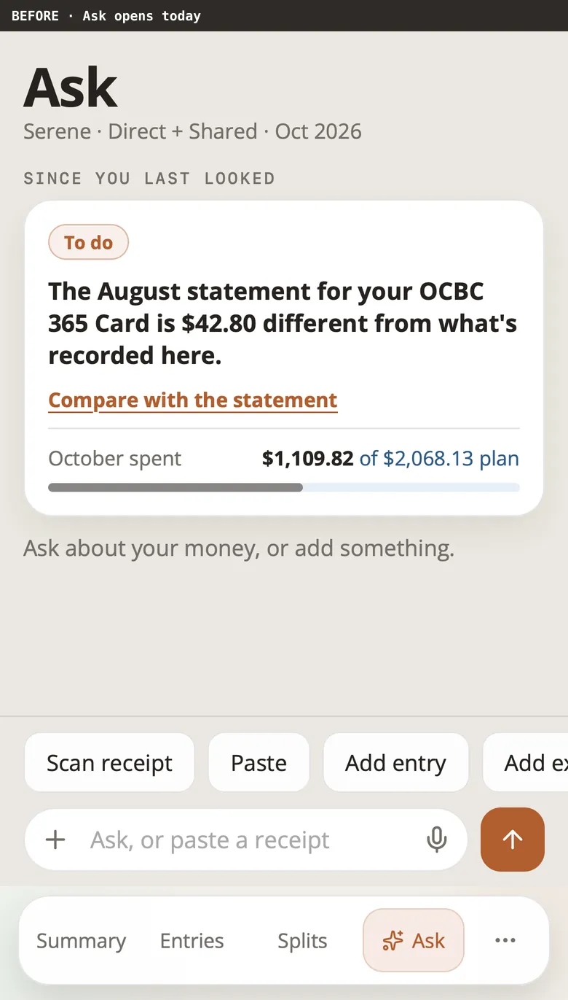 | 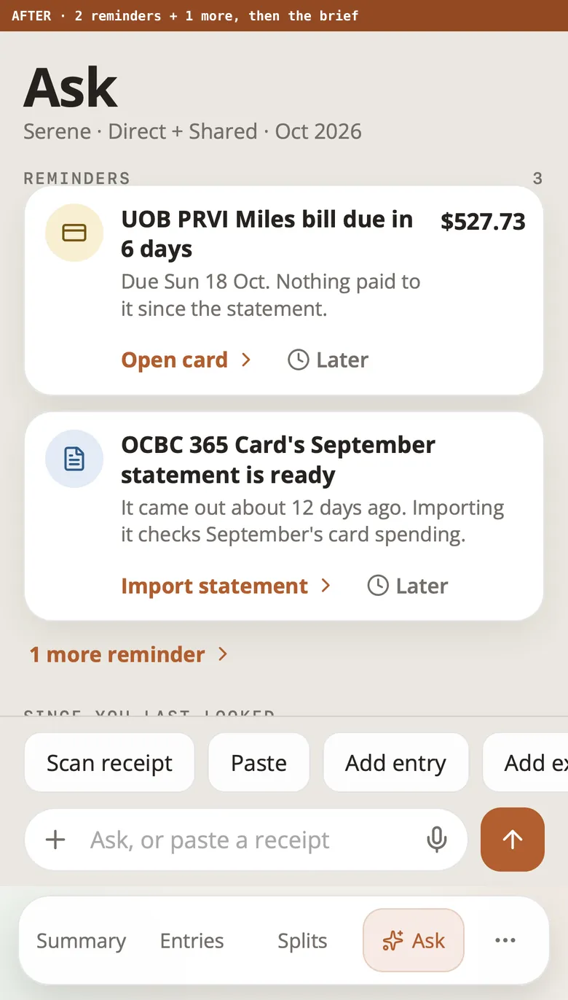 |
| | 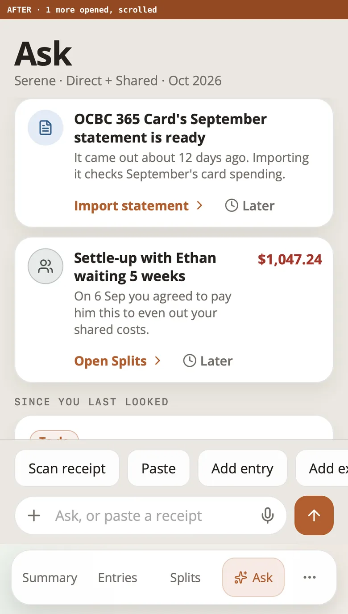 |
| | 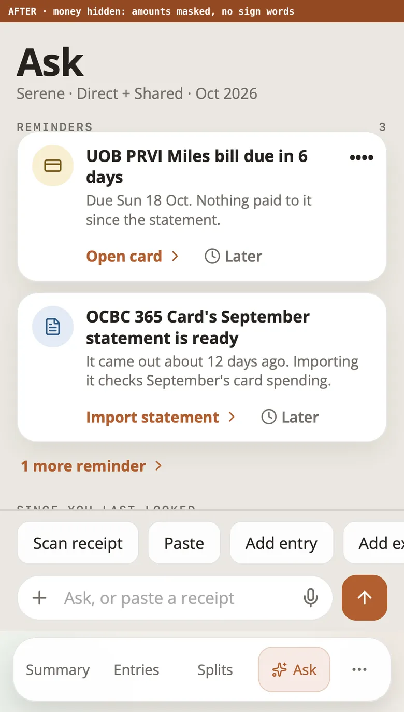 |

| Before (desktop) | After (desktop) |
| --- | --- |
| 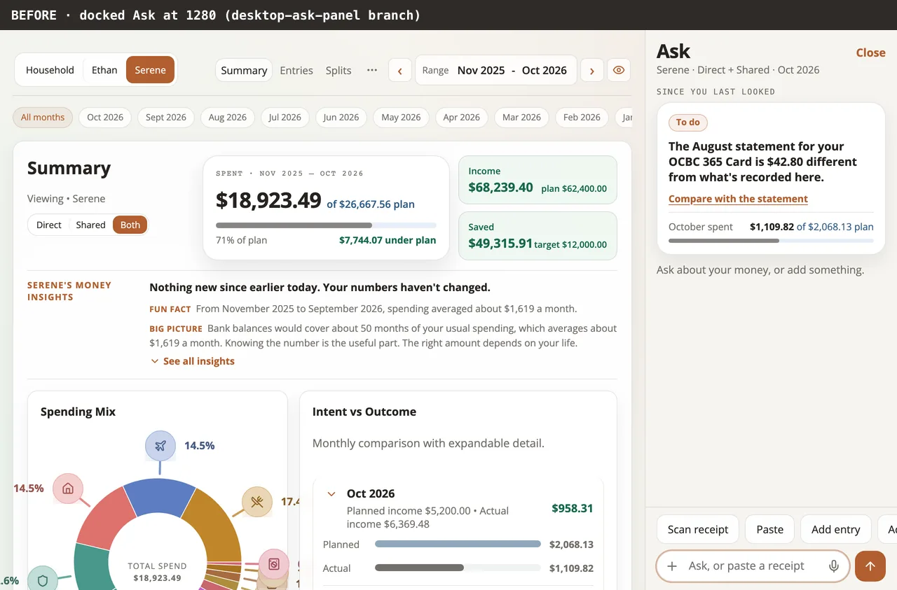 | 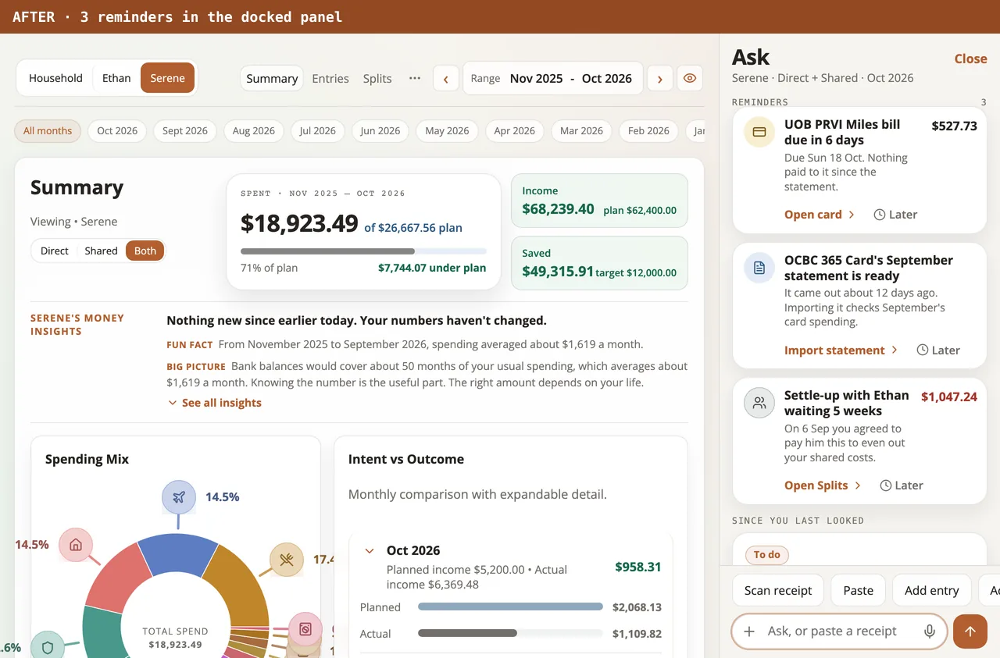 |

### 2. Month-close checklist

| Phone | Desktop |
| --- | --- |
| 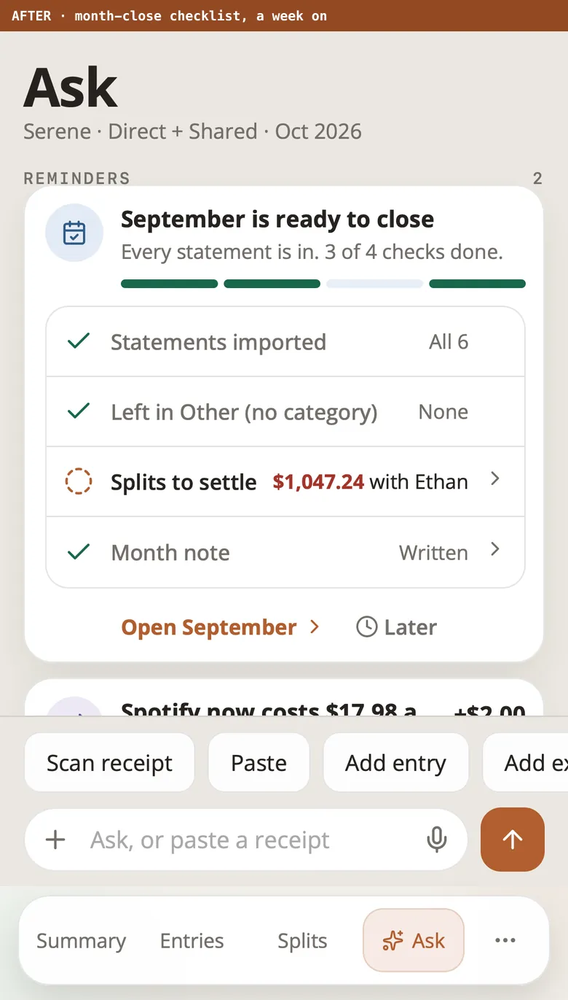 | 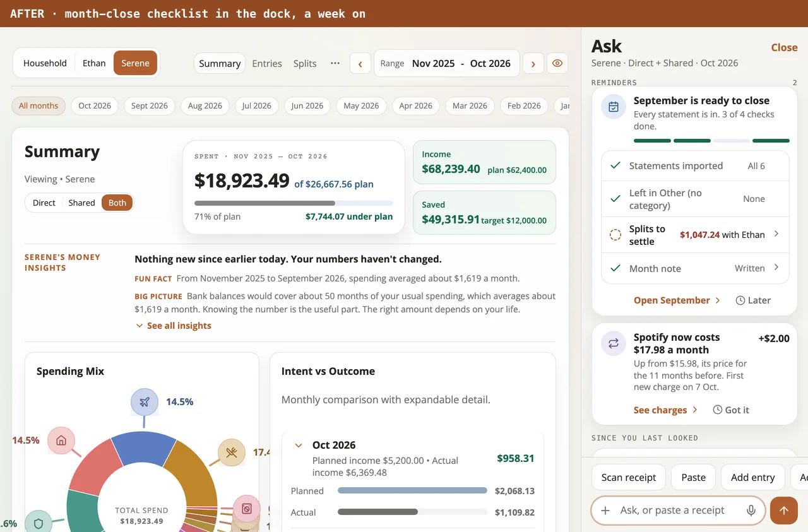 |
| 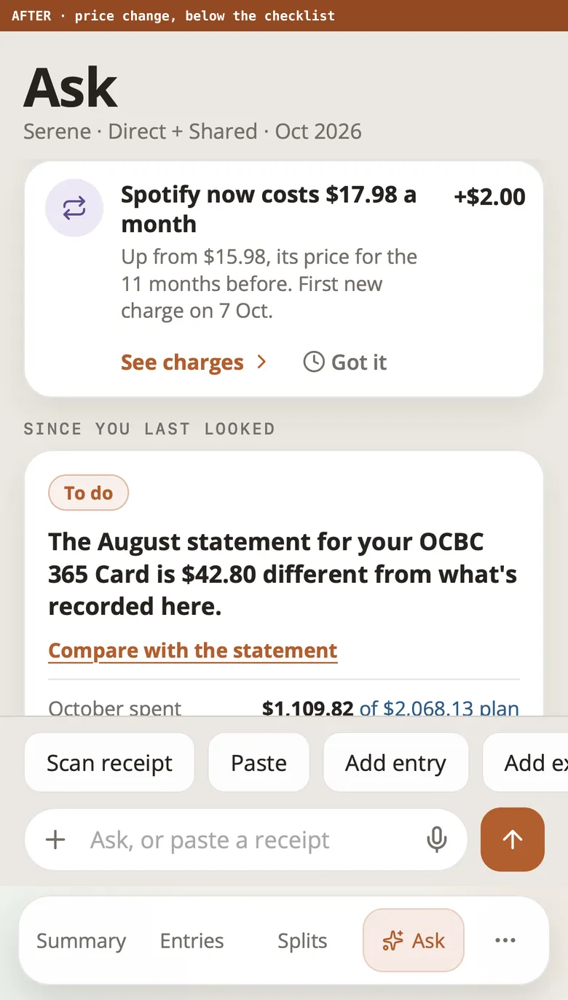 | |

### 3. Snooze

| Phone sheet | Desktop menu |
| --- | --- |
| 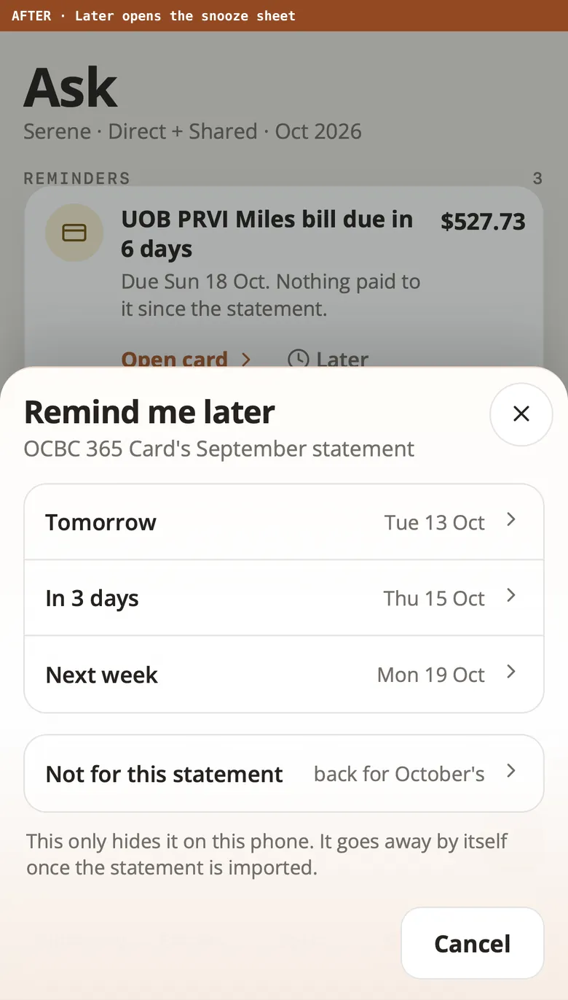 | 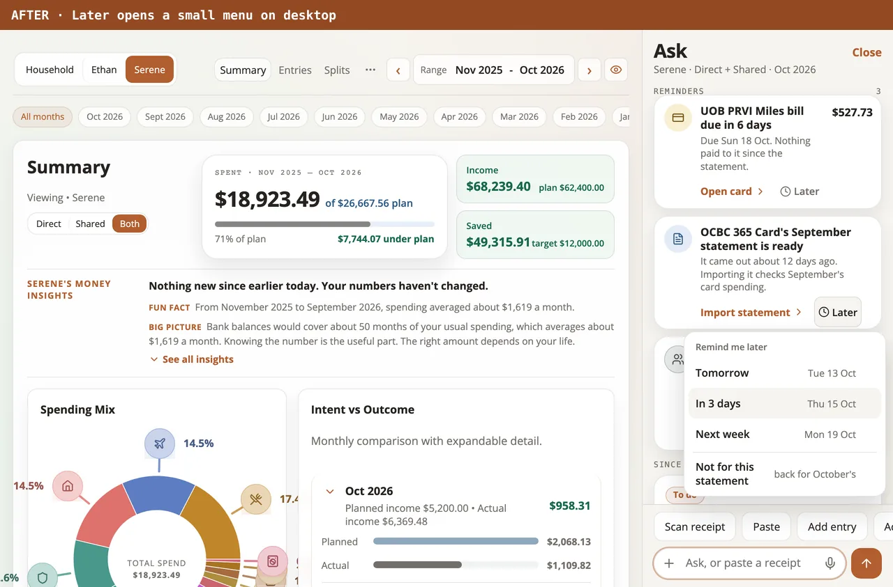 |

### 4. The Ask dot

| Before | After |
| --- | --- |
| 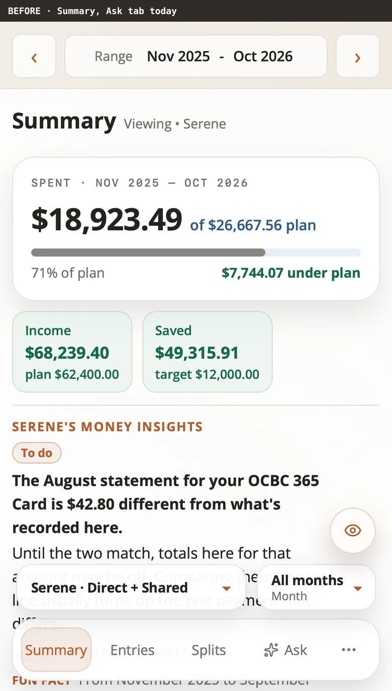 | 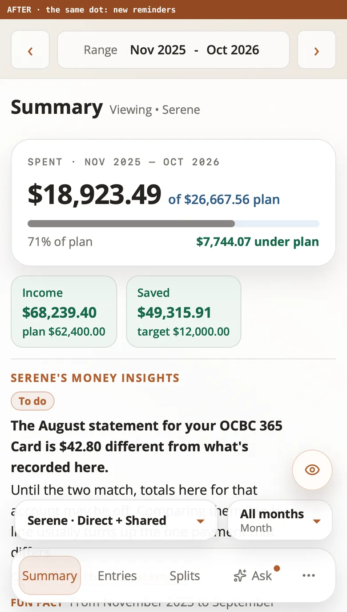 |
| 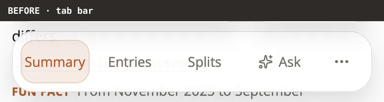 | 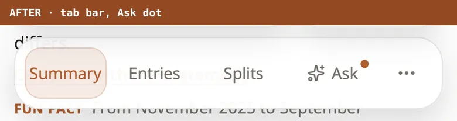 |
| 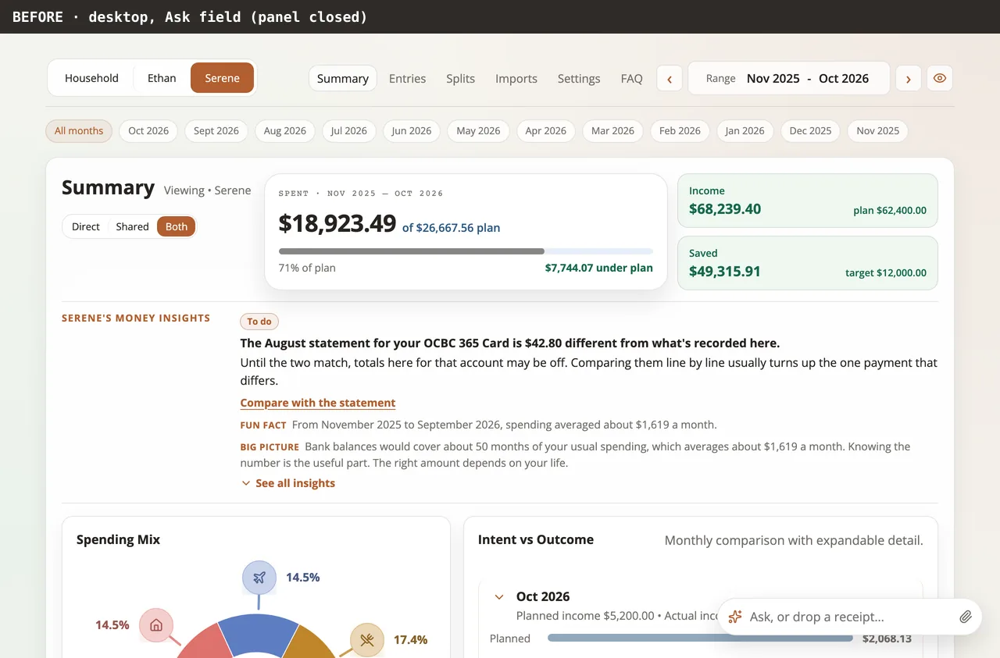 | 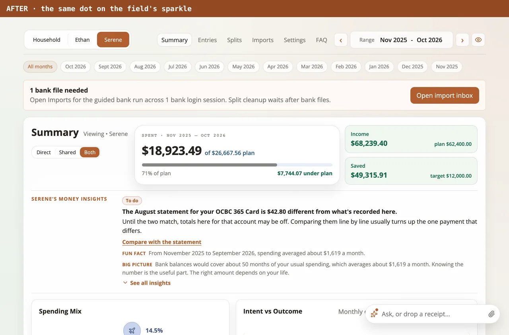 |
| 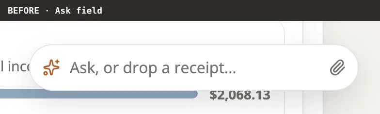 | 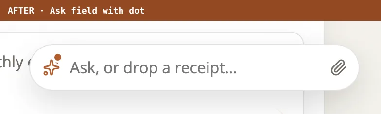 |

## Regenerating

`capture-mockups.mjs` (this folder) takes the pictures. It needs two
isolated showcase stacks on free ports (never 5173/8787), each built first
(`npx vite build`) and started with `scripts/e2e-stack.mjs`'s `startStack`
with `vars: { DEMO_DATASET: "showcase", DEMO_SEED_MONTH: "2026-10" }`, then
reseeded with `POST /api/demo/reseed`:

- phone: a checkout of `origin/master`;
- desktop: a checkout of `origin/desktop-ask-panel` (for example
  `git archive origin/desktop-ask-panel | tar -x -C <dir>`, with
  `node_modules` linked in).

```
node docs/proposals/reminders/capture-mockups.mjs \
  --phone-base http://127.0.0.1:<phone ui port> \
  --desktop-base http://127.0.0.1:<desktop ui port>
```

`--only phone` or `--only desktop` takes one set.
